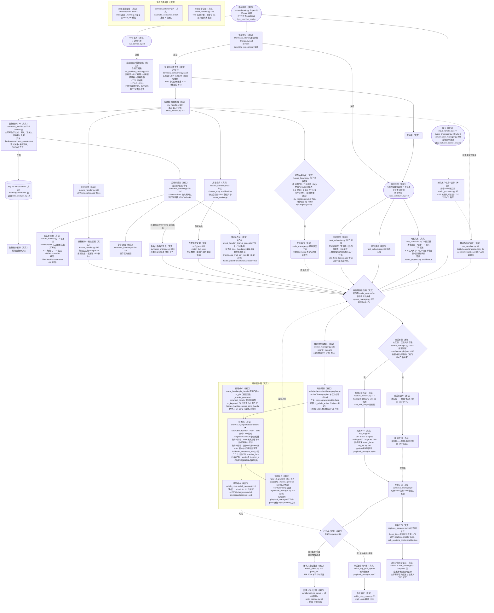

> **只读历史归档**（详图）— 2026-10-22 主干图分层时归档：本文件为 2026-10-20 图-码对齐版工程图的完整快照（含四态标注、逐节点 file:line 锚点与 Review record 0A 前提表 F1-F26）。
> **基线=commit dcf1ea51**（归档时 HEAD）；锚点未随 2026-10-22 后续批次（basic-config/danmaku-pricing/audio-playback）复核行号漂移。
> 现行权威流程图=主干图 [docs/flowchartTD.md](flowchartTD.md)（随批次维护）；"改链必改图"门禁只更新主干图，不回写本文件。

<!-- /autoplan restore point: "D:\\AI\\AUTOlive\\.gstack\\tmp\\autoplan\\main-autoplan-restore-20261020-180346.md" -->
## Implementation plan


<!-- autoplan-accepted:ceo -->
- 图结构修正义务（T1，本批）：flowchartTD.md 修正七处结构性错误——①写库顺序（数据统计/写库先于关键词过滤，F9）；②"优先级动态排序"改标注"静态优先级映射"（F12）；③"是否翻译"移到入队之前（Queue 上游，Classify/Capture 路径，F14）；④助播分支改标注"未实现，仅配置残留"（F15）；⑤GenerateAudio 三路改互斥两路（EDTalk 激活：数字人推送+字幕；非激活：本地播放+字幕，F18）；⑥Sync 连线方向修正（字幕=出队时推送+音频时长估算，不驱动播放/数字人，F20）；⑦"Listening关闭→SystemTasks"连线语义标注（任务调度不依赖监听开关，F2）。验证：七处逐一修正 + 全图对照前提表 F1-F26 复核。
- 图补全义务（T2，本批）：补遗漏环节——RVC 输出去向（虚拟音频设备→直播软件）、EDTalk→虚拟摄像头→OBS 出画链、双进程拓扑子图（frontend Popen 拉起 main + HTTP 互通）、监控自愈子图（webui _monitor_subprocesses/守护重建/异常报警重启）、弹幕前置管道（5 秒聚合/背压/R39 去重）、点歌音频直通路径（type=song 绕过 TTS）、积分回复出边（Points/Calc→播报进入播放链，F5）、语音对话骨架标注、写库先于过滤语义标注、断链图例（真实/断链/骨架/规划四态）、每节点 file:line 锚点注释、关键节点 config 开关默认值标注（integral.enable=false/choose_song.enable=false/key_mapping.enable=false 等当前实测默认）。验证：26 条前提表逐条在图上有对应 + Delight scan ①-⑤ 逐项核对 + 零孤儿边（每条断链/骨架状态的边必须绑定修复任务/裁决退役/显式延期登记三类处置之一）+ 前提表逐条回指代码（每条 F 至少一个非 .backup 的当前工作区 file:line 证据，锚点做存在性抽查 grep 命中即可）。
- 文档同步义务（T3，本批，P2）：README/拓扑文档引用新图；只同步有代码证据的前提（发现 3）；Verify: grep 旧图引用无残留。
- 断链修复义务（T5-T9，批准后独立批次）：批次框定（北极星）：本批修复的是观众可感知的互动闭环（答谢、点歌反馈、动态文案），是留存竞争力的直接构成。实施顺序按业务价值：T6 答谢（观众正反馈闭环）→ T9 动态文案（留存内容供给）→ T7 黑名单（直播安全）→ T8 闲时任务（空场填充）→ T5 按键映射（硬件互动，若无使用证据则退役评估）。按键映射从 my_handle.py.backup:2225/2307-2357 迁移完整实现——第一步差异对照（列出 backup 实现引用的配置项，逐一确认当前 config.json 存在，缺失项迁移时一并适配）+ 实施按符号定位（行号仅参考，发现 5）+ mock 串口测试；裁决规则（复制黑名单治理模式）：默认迁移，若差异对照发现配置面残缺或用户确认无串口硬件则退役并清理配置项，由实施期按规则二选一；答谢生产端恢复（event_handler 恢复 thanks 收集+即时/周期双通道测试）；黑名单接线或退役（裁决规则：默认接线——配置面与功能描述均在（任务书"设置黑名单，丢弃与该用户有关的任何信息"），恢复=接线到 comment_handle 前置；若实施时发现配置面残缺则降级退役并清理 UI，二选一由实施期按此规则执行）；闲时任务接线（空闲触发断言）；动态文案实装（生成+播报断言）。每任务自带回归测试，config 开关逐个灰度启用；每任务 Verify 必须含"对应图节点/边已更新"（改链必改图批次门禁，发现 6）。
- 聊天链 bug 修复义务（T4，P1）：chat_handler.py:171-175 补 datetime import；conversation_manager.py:64 类型契约修正；game 属性未赋值 AttributeError 消除。验证：config database.comment_enable 开启（开库开关）后聊天回复正常、game 分支不崩。
- 延期义务（TODOS）：T10 语音对话链接通（L，触发条件锚定：T5-T9 断链批次落地后下一批，不无限期）；写库/过滤顺序语义决策；前提表→运行时冒烟断言（每条 F 前提对应一条运行期可验证检查，把本次审计投入复利化）。
- NOT in scope：助播功能重新实现；优先级动态排序改造；fastrag 接线；上游组件（DanmakuListener/GPT-SoVITS/RVC/EDTalk）内部审查。
<!-- /autoplan-accepted:ceo -->

<!-- autoplan-accepted:eng -->
- Scope Challenge 结果：scope accepted as-is（ENG 19 项发现全为任务体细化非范围增减；复杂度门 B 跳过——本批 4-5 文件 0 新类）。
- 开工前置三项（native voice 有条件批准条件，全部并入义务块）：S-1 串口安全——每用户+全局频率上限+触发去重（复用 *_single_sentence_trigger_once）+限速回归测试+串口触发与文案/本地音频灰度分开启用；T-c 迁移差异对照扩四类（配置项/模块导入/方法符号/运行上下文——backup:2351 同步处理器内 asyncio.run() 不可入事件循环、luoxi_project 节已消失按裁剪预登记）；E-3+H-1 DB 写窄 try 隔离+“DB 异常时回复链不中断”负向测试+T4 验证离线执行（database.comment_enable 已实测 true，NameError 当前即触发被静默吞掉）。
- Verify 增补：T-a 锚点全量脚本校验（26 条 F 逐一 grep 符号，从抽查升级）；T-b mermaid lint+四态断言脚本（每节点/边恰属四态之一、断链态边均绑定三类处置之一）；T2 补积分播报优先级标注（integral:20）+匹配失败出边（config.json:362 实配）+溢出策略标注（丢旧+计数）；T3 追加断链批次状态注记。
- 任务体细化：T6 即时答谢限流（聚合阈值 N 人合并一条+每分钟上限+百连入场回归，ENG E-2）；T7 黑名单匹配语义写死（UID 优先+NFKC+去空白+casefold+绕过用例，ENG S-2）；T9 动态文案注入防护（改写输入仅限模板+白名单变量+弹幕原文先过过滤链+注入回归，ENG S-3）；H-2 conversation_manager 契约形状=dict 同构禁 str 兼容；H-3 T5 用户不可达默认=退役（git 可逆）。
- TODOS 收集（Eng runs last）：5 项延期+1 交叉注记已 auto-write 至 TODOS.md 2026-10-20 节（T10 锚定/写库语义/断言化/backup 清理/图纪律推广/A 组实测交叉）。
- 测试计划工件已落盘：~/.gstack/projects/Eikwang-AUTOlive/admin-main-eng-review-test-plan-20261020-194500.md（Critical Paths 8 项带 Value card、GAP 15 全部绑定任务零孤儿、Pending Decisions=0）。
- NOT in scope（Eng 确认）：无新组件/无架构推翻/上游组件内部不动；现有套件（门禁 A 后全绿）不受本批触碰。
<!-- /autoplan-accepted:eng -->
## Review record

### CEO Step 0 — 0A 前提挑战（Premise Challenge）

真实问题：系统经多轮整合与代码拆分后，用户梳理了主线运行流程图，需要验证"图=代码现实"，找出流程描述错误与真实断链。审查对象是流程图的准确性 + 流程本身的功能缺陷。不作为（do-nothing）成本：流程图作为运维/开发心智模型持续误导（图中在用的功能实际已断、图中不存在的主链分支被当作现实）。

**前提表（26 条，file:line 证据，unverified=0）**：

| # | 流程图声明 | 代码证据 | 结论 |
|---|---|---|---|
| F1 | System→弹幕监听 | main.py:159-163 后台拉起；utils/danmaku_consumer.py:264/500-550 托管+派发 | verified |
| F2 | Listening关闭→SystemTasks | danmaku_consumer.py:1113-1115 enabled=false 不构建；task_scheduler.py:272-276 任务线程与弹幕无关 | 曲解（连线语义不成立：任务调度不依赖监听开关） |
| F3 | 分类处理 | my_handle.py:367-371; timer_handler.py:243-300; comment_handler.py:240-385 | verified |
| F4 | 积分系统存在 | feature_handler.py:508-539 链路完整；触发 comment_handler.py:263-266 + event_handler.py:43/69/95；config integral.enable=false 默认关 | verified |
| F5 | Points→Calc 计算积分（图中终点） | feature_handler.py:599-645 积分档位回复产生 TTS 播报 | 图缺出边（积分回复未画进播放链） |
| F6 | 按键映射→发送串口 | feature_handler.py:855-877 + utils_handler.py:103-130 均 TODO 空壳；完整实现遗留在 my_handle.py.backup:2225/2307-2357（重构丢失）；serial_manager.py:9 运行链零调用 | 断链 |
| F7 | 点歌→匹配成功→Queue | feature_handler.py:307-487; synthesis_manager.py:153-168 type=song 音频路径直通播放队列；RVC 翻唱异步 cover_worker.py; choose_song.enable=false | verified（补充：入队为音频文件路径） |
| F8 | 关键词&黑名单过滤 | comment_handler.py:26-102（违禁词/长度/符号）+ danmaku_consumer.py:910-915（监听侧关键词）；黑名单 feature_handler.py:879-906 **无调用者** | 部分（黑名单死链） |
| F9 | Filter→Stats→DB 顺序 | comment_handler.py:255-260 danmu 写库**先于** :272-288 过滤 | 顺序颠倒 |
| F10 | Filter→Interact 答谢&互动 | 答谢生产端丢失：event_handler gift/entrance/follow 不再写 thanks 数据，timer_handler.py:102-202 消费端空转；即时答谢仅存 backup:3077-3100 | 死链 |
| F11 | 待处理消息队列 | audio_core.py:54-59; queue_manager.py:139-253 双队列 | verified |
| F12 | 优先级动态排序 | queue_manager.py:139-253 静态 priority_mapping+插入线性找位 | 名不副实（静态非动态） |
| F13 | 动作编排待开发 | 全仓库无骨架/TODO/占位；audio_handler.py:62-115 直调无编排层 | 图注正确（未开发） |
| F14 | 是否翻译（Compile 后） | my_translate.py:35-63; 触发点 comment_handler.py:357-361 / chat_handler.py:272-276 —— 入队**之前** | 位置错 |
| F15 | 助播知识库/助播TTS 分支 | 仅剩类型名 queue_manager.py:160-161、synthesis_manager.py:204-219 + 前端配置；无任何运行链触发器 | 不存在（配置残留） |
| F16 | 系统知识库 | 本地问答 feature_handler.py:144-305 真实；fastrag frontend/main.py:309 拉起但 utils/ 零调用；chat_with_file.py:18 死代码 | 部分 |
| F17 | 随机语速 | my_tts.py:106-109/163-169 speed_factor 合成侧 + playback_manager.py:96-99 pydub 播放侧回退 | verified（双路径） |
| F18 | GenerateAudio 三路分发 | EDTalk 激活：push_full+字幕，本地播放跳过（playback_manager.py:109-112）；非 EDTalk：本地播放+字幕无 AvatarAI | 三路不成立（互斥两路） |
| F19 | 字幕打印→对齐同步 | captions_manager.py:164 出队时 push; :179-211 keep_time=音频时长估算; E-2 变速折算; E-4 暂停挂起 | verified（非播放回调） |
| F20 | Sync→SystemPlay + Sync→AvatarPlay | 字幕不驱动播放/数字人；播放由 playback_manager.py:47-164 单循环驱动 | 连线方向错误 |
| F21 | 数字人推理→独立播放 | edtalk_client.py:88/144 push_full 单飞行句背压; edtalk/realtime_serve/main.py; unity_capture.py:50-69 虚拟摄像头 | verified（缺虚拟摄像头→OBS 出画出口） |
| F22 | 待播放音频列表→系统播放 | builtin_play_center.py:75/282（mp3→wav 转码 :193-198）; playback_manager.py:140-156 | verified |
| F23 | 聊天→捕获用户信息&语音 | input_handler.py:17-167; audio_processor.py:44-177 有实现；conversation_manager.py:221-240 do_listen_and_comment **空框架**（循环体仅 sleep） | 骨架（语音对话链未接通，ASR 未接入） |
| F24 | RVC→指定麦克风转换音色 | rvc_realtime_service.py:39/199 sounddevice.Stream 麦克风→RVC→输出设备全双工；rvc_service.py:33-75 子进程托管；HTTP 控制面 :390-448 | verified（缺输出去向标注：虚拟音频设备→直播软件） |
| F25 | RVC 不影响数字人口型音频 | EDTalk 推送链无 RVC 介入（edtalk_client.py）；旧播放链变声 so_vits_svc synthesis_manager.py:278-301 为独立通道 | verified |
| F26 | 点歌经数字人口型 | type=song → playback_manager.py:109-112 EDTalk 模式 push_full | verified |

### 0B 现有代码映射（What already exists，证据=A 节全链路核实）

弹幕链：DanmakuListener 进程内托管（main.py:159-163）→ 桥 hook（danmaku_consumer.py:208-259）→ 5 秒聚合/背压/R39 去重（:77-145/:426-455/:1159-1202）→ my_handle.process_data（my_handle.py:367-371）→ timer_handler 遗忘窗口+分派 → comment/event/feature/chat/like/follow 六 handler。播放链：双队列（audio_core.py:54-59）→ synthesis_manager（TTS inproc gpt_sovits_inproc.py, main.py:137-148 / edge-tts）→ queue_manager 优先级 → playback_manager 单消费循环 → builtin_play_center（pygame/pyaudio）或 EDTalk push_full → 虚拟摄像头 → OBS。字幕链：captions_manager（出队 push+时长估算）→ socket.io web 页（web_server.py:92-159）+ 文件模式双通道。任务链：task_scheduler.py 定时+文案线程（闲时未接线）。语音链：input_handler/audio_processor 有实现但 conversation_manager 空框架。RVC：独立子进程音频设备回路+训练管线。监控：webui _monitor_subprocesses（frontend/main.py:857-921）+ DanmakuListener 守护重建（danmaku_consumer.py:836-857）+ 异常报警自愈重启（event_handler.py:175-232）。

### 0C Dream State Mapping

```
CURRENT STATE                  THIS PLAN                     12-MONTH IDEAL
─────────────────────────      ─────────────────────────     ─────────────────────────
三切片落地后系统:              流程图与代码对齐(修图+        稳定直播整合产品:
主链路(弹幕→LLM→TTS→          标注断链);断链修复任务        一键开播/弹幕驱动/
播放/字幕/数字人)真实在        入任务表;真实流程环节         多平台/可商用,
跑;6 条断链(按键映射/          (前置管道/虚拟摄像头          配置面=功能面一一对应,
答谢/黑名单/闲时/文案/         出画/双进程/监控)补进图        流程图=可信运维文档
语音对话)+2 处图结构错误
```

### 0E 模式：SELECTIVE EXPANSION（autoplan 指定，handoff 已记录）

### 0F/0G SELECTIVE EXPANSION 检查与扩展处置（auto-decide，P2 boil lakes）

HOLD 三检查：①复杂度——审查产出=图修正+任务表，不新增运行时组件，无复杂度风险；②最小改动——修正图与断链登记是达成"确保运行流程正确"的最小充分集；③不变量——保持已定架构决策（进程内弹幕托管/写者矩阵/内置播放器/EDTalk 推送契约）。

扩展候选处置：
- **图结构修正（ACCEPTED，S，<1d）**：F9 写库顺序（Stats 移到 Filter 前）、F14 TranslateQ 位置（移到入队前）、F15 助播分支（改标注"未实现，仅配置残留"）、F18 三路改互斥两路、F20 Sync 连线方向修正、F12 排序改"静态优先级"、F2/F13 标注、F24 RVC 输出去向、F21 补虚拟摄像头→OBS、F23 语音链标注"骨架未接通"。全部 <1d CC。
- **断链修复任务（入 Implementation Tasks，批准后实施）**：按键映射迁移 backup 实现（S-M）；答谢生产端恢复（M）；黑名单接线或退役（S）；闲时任务接线（M）；动态文案实装（S-M）；语音对话链接通（L→TODOS）。
- **10x 检查**：流程图作为"系统唯一可信运行文档"的 10x 价值=后续排障/接手/迭代都以此图为导航；2x 成本（修图+断链登记）极低。
- **Delight scan（5 项 30 分钟级）**：①图节点双形态标注（真实/断链/骨架/规划）图例；②每节点 file:line 锚点注释；③双进程拓扑子图；④监控自愈子图；⑤config 开关默认值标注。①-⑤ 全部 ACCEPTED（修图任务一部分）。

### 0I Temporal Interrogation

| 时段 | 实施者会遇到的问题 | 处置 |
|---|---|---|
| HOUR 1 | 图-码双源真相：先修图还是先修链？修图不改代码（本批），断链修复独立批次 | 任务表分"修图"（本批）与"修链"（批准后）两组 |
| HOUR 2-3 | backup 文件里的完整实现迁移时的 config 键漂移（key_mapping.enable 语义） | 迁移前 grep 键消费方；D-20 矩阵登记 |
| HOUR 4-5 | 答谢生产端恢复会改变直播 audible 行为（礼物/入场开始出声）——需用户确认开启时机 | 任务标注"默认跟随 config 答谢开关" |
| HOUR 6+ | 图更新后旧图引用方（README/拓扑文档）同步 | 图修正任务含文档同步 |

### CEO 前置结论

流程图 = "理想运行流程"而非"现实运行流程"：26 条前提中 10 条与代码现实不符（3 结构错误 + 6 断链 + 1 顺序错），另有 10+ 真实环节未画。审查发现转入 Sections 与任务表。

### Sections 1-11 审查产出（CEO）

**Section 1 架构**：

```
                       ┌─────────────── frontend 进程 (NiceGUI :8080) ───────────────┐
                       │  webui 配置面/监控(_monitor_subprocesses)/数据分析/EDTalk拉起 │
                       └──────┬──────────────────────────────────┬───────────────────┘
                        Popen │ HTTP /sys_cmd /callback /set_config                  │ 拉起
                       ┌──────▼──────────── main 进程 (运行链) ───────────────────────┐
 [直播间] ⇄ DanmakuListener(进程内托管) → 聚合/去重/背压 → my_handle.process_data          │
                                             ├→ comment/event/feature/chat handlers        │
                                             │   ├→ 过滤(违禁词) [黑名单死链] [按键映射死链]  │
                                             │   ├→ 翻译(入队前) → LLM(custom_llm OpenAI)    │
                                             │   ├→ 积分(enable=false) → 档位回复            │
                                             │   └→ 点歌(本地音频直通/RVC翻唱异步)           │
                                             ├→ [答谢死链] [闲时未接线] [文案只记日志]        │
                                             └→ 双队列(message/voice_tmp) → synthesis(TTS)  │
                                                 → queue(静态优先级) → playback 单循环      │
                                                     ├→ builtin 播放(或 EDTalk push_full)  │
                                                     │    └→ 虚拟摄像头 → OBS 出画          │
                                                     └→ 字幕双通道(文件/web socket.io)      │
 [麦克风] → RVC 实时变声子进程(独立音频回路) → 虚拟音频设备 → 直播软件                      │
 [语音对话骨架] input_handler/audio_processor(有实现) ↔ conversation_manager(空框架)        │
 ─────────────────────────────────────────────────────────────────────────────────────────┘
```

发现：①双进程拓扑与监控自愈链未入图（补充）；②RVC 独立回路与主链零数据流——图上并列分支正确，需标注输出去向；③EDTalk 模式播放互斥（本地播放跳过）是图三路错误的根源。无新增耦合风险。

**Section 2 Error & Rescue Map**：

| CODEPATH | 可能出错 | 异常类 | 救援 | 用户看到 |
|---|---|---|---|---|
| chat_handler.talk_handle | chat_handler.py:171-175 缺 datetime import | NameError（开库开关即触发） | 无 ← GAP | 聊天回复静默失败 |
| conversation_manager.talk_handle | :64 传 str+错误 type "comment" | 类型/契约错误 | 无 ← GAP | 语音对话无响应 |
| chat_type=game | chat_handler.py:240/comment_handler.py:325 引用未赋值属性 | AttributeError | 无 ← GAP | 崩溃/分支失效 |
| 弹幕入口未就绪 | my_global.my_handle 未初始化 | 丢弃+日志 | Y（丢弃不崩） | 弹幕无响应 |
| TTS 合成失败 | 引擎异常 | 计数→报警→超阈值重启 | Y（event_handler.py:175-232） | 报警音频/重启 |
| DanmakuListener 崩溃 | 守护重建 3 次置红 | Y（danmaku_consumer.py:836-857） | 状态红 | 监听失效 |
| 积分写库 | DB 锁/字段 | 退避重试 feature_handler.py:558-571 | Y | 延迟计入 |

GAP 处置：三处聊天链 bug 入任务表（修复 <1d，P2 boil lakes 自动批准范围）。

**Section 3 安全**：无新增攻击面（审查产出为图与任务）。既有面沿用既定决策（webui 127.0.0.1 收敛已落地）。LLM 提示注入为既有风险非本批引入。

**Section 4 数据流边界**：写库先于过滤（F9）意味着被违禁词命中的弹幕原文已入库——数据分析读到的含违禁词原文，图修正须连同此语义决策一起标注（写库前过滤 or 入库原文+标记）。默认保持现状（写库在先）只修图，语义决策登记 TODOS。聚合窗口 5 秒内同用户多弹幕合并——图未画（补充）。

**Section 5 代码质量**：断链根因=my_handle.py→handlers/ 拆分迁移丢失（按键映射/答谢生产端/黑名单接线）——拆分批次缺"迁移完整性清单"验证。流程图审查暴露拆分债，修复任务引用 backup 源。

**Section 6 测试**：修图任务无测试面（文档）。断链修复任务每个需回归测试：按键映射（mock 串口写入断言）、答谢（gift/entrance 事件→task_data 断言）、聊天链 bug（回归 NameError/AttributeError 消失+正常路径）。现存断链无测试覆盖是既成事实，修复任务自带测试。

**Section 7 性能**：无新增性能面。静态优先级插入 O(n) 队列长度有界（filter_queue max_len）——无阻塞项。

**Section 8 可观测性**：图例标注（真实/断链/骨架）本身是可观测性投资；监控子图入图（崩溃监控/异常报警/守护重建）。断链功能一旦修复需状态条可见（沿用 D-1 状态条决策）。

**Section 9 部署**：本批=文档+任务表（无运行时变更，零部署风险）。断链修复批次：答谢/按键映射启用影响直播行为，需灰度（config 开关逐个开）。

**Section 10 长期轨迹**：流程图对齐后可逆性 5/5（纯文档）；断链修复可逆性 4/5（git+config 开关）；拆分债（backup 残留）修复后消除。1 年问题：图例机制让图随代码演进保持可信——需要"改链必改图"纪律（登记 TODOS 轻量流程）。

**Section 11 设计与 UX**：SKIPPED（no UI scope）。

### CEO Failure Modes Registry

| CODEPATH | FAILURE MODE | RESCUED? | TEST? | USER SEES? | LOGGED? |
|---|---|---|---|---|---|
| 按键映射链 | 弹幕触发无串口输出（TODO 空壳） | N | N | 静默 ← CRITICAL GAP | N |
| 答谢链 | 礼物/入场/关注无答谢播报（生产端丢失） | N | N | 静默 ← CRITICAL GAP | N |
| 黑名单 | 黑名单用户消息照常处理 | N | N | 静默 ← CRITICAL GAP | N |
| 闲时任务 | 空闲期永不触发（未接线） | N | N | 静默 ← CRITICAL GAP | N |
| 动态文案 | 只记日志不播放 | N | N | 静默 ← CRITICAL GAP | N |
| 语音对话 | 按键/语音对话无响应（空框架） | N | N | 静默 ← CRITICAL GAP | N |
| 聊天回复（开库） | NameError 静默失败 | N | N | 回复缺失 | 部分 |
| game 分支 | AttributeError | N | N | 崩溃分支 | N |
| 弹幕主链 | 各类异常 | Y（聚合/背压/守护） | 部分 | 状态条 | Y |
| TTS/播放链 | 合成失败/设备异常 | Y（报警+重启） | 部分 | 报警 | Y |
| EDTalk 链 | 推送失败 | Y（背压+跳过本地播放防双声） | 实测通过 | 口型停止 | Y |
| 积分链 | DB 异常 | Y（退避重试） | 门禁A后 | 延迟计入 | Y |

CRITICAL GAP = 6 条断链 + 2 聊天链 bug——全部转入 Implementation Tasks（修链任务自带测试后 GAP 消除；不修复则图上必须标注断链，消除"图说谎"）。

### Implementation Tasks

Synthesized from this review's findings. Each task derives from a specific finding above. Run with Claude Code or Codex; checkbox as you ship.

**组一：修图（本批直接可做，纯文档）**
- [ ] **T1 (P1, human: ~1h / CC: ~10min)** — flowchartTD.md — 图结构修正七处
  - Surfaced by: 0A 前提表 F9/F12/F14/F15/F18/F20/F2
  - Files: docs/flowchartTD.md
  - Verify: 七处逐一修正 + 全图对照前提表 F1-F26 复核
- [ ] **T2 (P1, human: ~2h / CC: ~30min)** — flowchartTD.md — 节点标注体系+遗漏环节补图
  - Surfaced by: 0G delight scan + Section 1/4（RVC 输出去向/虚拟摄像头出画/双进程子图/监控子图/聚合窗口/写库先于过滤语义/点歌音频直通/积分回复出边 F5/语音对话骨架标注/断链图例/每节点 file:line 锚点/config 开关默认值标注）
  - Files: docs/flowchartTD.md
  - Verify: 26 条前提表逐条在图上有对应 + Delight scan ①-⑤ 逐项核对 + 零孤儿边（每条断链/骨架边绑定任务/退役/延期三类处置之一）+ 前提表逐条回指代码（非 .backup 的 file:line，锚点存在性抽查）
- [ ] **T3 (P2, human: ~1h / CC: ~15min)** — 文档同步 — README/拓扑文档引用新图
  - Surfaced by: 0I HOUR 6+
  - Files: README.md, docs/（拓扑文档）
  - Verify: grep 旧图引用无残留

**组二：修链（T4 本批 P1；T5-T9 批准后独立批次）**

批次框定：本批修复的是观众可感知的互动闭环（答谢、点歌反馈、动态文案），是留存竞争力的直接构成。实施顺序按业务价值：T6 答谢 → T9 动态文案 → T7 黑名单 → T8 闲时任务 → T5 按键映射（若无使用证据则退役评估）。每任务 Verify 必须含"对应图节点/边已更新"（改链必改图批次门禁）。
- [ ] **T4 (P1, human: ~4h / CC: ~30min)** — 聊天链三 bug 修复（talk_handle datetime import/类型契约/game 属性；实施按符号定位，行号仅参考）
  - Surfaced by: Section 2 GAP 三处
  - Files: utils/handlers/chat_handler.py, utils/conversation_manager.py
  - Verify: 回归测试（config database.comment_enable 开启后聊天回复正常、game 分支不再 AttributeError）
- [ ] **T5 (P2, human: ~1d / CC: ~1h)** — 按键映射链修复（从 my_handle.py.backup:2225/2307-2357 迁移完整实现到 handlers；第一步=差异对照 backup 引用配置项逐一确认当前 config 存在，缺失一并适配；实施按符号定位）
  - Surfaced by: F6 断链；Failure Modes CRITICAL GAP；裁决规则：默认迁移，差异对照发现配置面残缺或用户确认无串口硬件则退役清理配置项
  - Files: utils/handlers/feature_handler.py, utils/utils_handler.py（迁移 serial_manager 接线）
  - Verify: mock 串口写入断言测试 + key_mapping.enable 开关行为 + 对应图节点/边已更新
- [ ] **T6 (P2, human: ~1d / CC: ~1.5h)** — 答谢生产端恢复（event_handler gift/entrance/follow 恢复 thanks 数据收集，即时+周期双通道）
  - Surfaced by: F10 死链；Failure Modes CRITICAL GAP
  - Files: utils/handlers/event_handler.py, utils/handlers/timer_handler.py
  - Verify: gift/entrance/follow 事件→task_data["thanks"] 断言 + 周期触发播报 + 对应图节点/边已更新
- [ ] **T7 (P3, human: ~2h / CC: ~20min)** — 黑名单处置（默认接线到 comment_handle 前置；配置面残缺则降级退役并清理 UI）
  - Surfaced by: F8 黑名单死链；裁决规则=配置面与功能描述均在则接线，残缺则退役（实施期按规则执行）
  - Files: utils/handlers/feature_handler.py, utils/handlers/comment_handler.py
  - Verify: 黑名单用户弹幕被拦截断言 + 对应图节点/边已更新
- [ ] **T8 (P3, human: ~4h / CC: ~1h)** — 闲时任务接线（task_scheduler.do_task 启动+触发机制三选一实现）
  - Surfaced by: F2/F10 相关；Failure Modes CRITICAL GAP
  - Files: utils/task_scheduler.py, utils/handlers/event_handler.py
  - Verify: 队列空闲 N 秒→闲时文案触发断言 + 对应图节点/边已更新
- [ ] **T9 (P3, human: ~4h / CC: ~1h)** — 动态文案实装（LLM 生成→TTS 入队播放）
  - Surfaced by: 任务模块文案只记日志（task_scheduler.py:259-261）
  - Files: utils/task_scheduler.py
  - Verify: 周期到点生成文案并播报断言 + 对应图节点/边已更新
- [ ] **T10 (P3→TODOS, human: ~1周 / CC: ~半天)** — 语音对话链接通（conversation_manager 框架填充+ASR 接入）
  - Surfaced by: F23 骨架（L 工作量，超 <1d 线）
  - Files: utils/conversation_manager.py, utils/audio_processor.py
  - Verify: 按键录音→ASR→LLM→TTS 全链手动实测

### NOT in scope
- 语音对话链接通实施（T10，工作量 L，登记 TODOS）
- 写库先于过滤的语义变更（保持现状，语义决策登记 TODOS）
- 优先级"动态排序"改造（静态映射为既定设计，图改标注即可）
- 助播功能重新实现（断链处置=图上标注"未实现"，是否重建属产品决策）
- fastrag 知识库接线（utils 零调用是既有状态，属 LLM 配置面范畴）
- 上游组件（DanmakuListener/GPT-SoVITS/RVC/EDTalk）内部流程审查（各自独立开发纪律）

### Deferred to TODOS.md
- T10 语音对话链接通（L；触发条件锚定：T5-T9 断链批次落地后下一批，不无限期）
- 写库/过滤顺序语义决策
- 前提表→运行时冒烟断言（每条 F 前提对应一条运行期可验证检查，审计投入复利化）

### Decision Audit Trail

| # | Phase | Decision | Classification | Principle | Rationale | Rejected |
|---|-------|----------|----------------|-----------|-----------|----------|
| 1 | ceo | 审查模式 SELECTIVE EXPANSION（autoplan 指定） | Mechanical（覆盖规则） | — | 审查产出=图修正+任务表 | — |
| 2 | ceo | 图结构五处修正 ACCEPTED（本批直接修图） | Mechanical | P2 boil lakes | <1d CC，纯文档零风险 | 仅登记不改 |
| 3 | ceo | 六条断链入修复任务表（批准后实施），语音对话除外 | Taste | P1 完整性 | 断链=用户"确保流程正确"的直接标的；语音链 L 超线 | 全部自动实施 |
| 4 | ceo | 助播分支处置=图上标注"未实现"而非删除 | Taste | P5 explicit | 配置面/UI 仍存在（config.example.json:1032），删图与 UI 矛盾 | 直接删除节点 |
| 5 | ceo | 写库顺序保持现状只修图，语义决策延期 | Mechanical | P6 + P3 | 变更写库顺序影响数据分析口径，需用户裁决 | 立即改顺序 |
| 6 | ceo | 聊天链三 bug 修复升级 P1 | Mechanical | P2 | NameError/AttributeError 是运行期故障非死链 | 与断链同优先级 |
| 7 | ceo | Codex 外部声部不可用（not_installed），CEO 阶段 subagent-only | Mechanical | — | Phase 0.5 预检 | — |
| 8 | ceo | Spec loop 3 轮闭环：7 项（C-1/C-2/L-1/L-2/N-2/N-3/N-4）全部修复，末轮 PASS 8.5/10 | Mechanical | P1 | 修复均文本级，验证落盘 | — |
| 9 | ceo | native CEO voice 10 项发现全部接受（前提表回指代码/零孤儿边/改链必改图升批次门禁/T5 差异对照+退役规则/T10 触发锚定/价值排序/业务框定） | Mechanical | P1+P2+P5 | 文档级治理增强 <1d，无 User Challenge | 维持原计划不带条件 |
| 10 | ceo | "改链必改图"从 TODOS 提升为 T5-T9 每任务 Verify 门禁（native 发现 6 采纳方案 c） | Mechanical | P1 | 紧邻下一批就改代码，延期即漂移 | 留在 TODOS |

### CEO DUAL VOICES — CONSENSUS TABLE（Codex not_installed，六格 N/A；native 独立完成）

| Dimension | Claude (native voice) | Codex | Consensus |
|---|---|---|---|
| 1. Premises valid? | 有条件批准：前提表需逐条回指代码+锚点核验（发现 3） | — | N/A |
| 2. Right problem to solve? | 是（先立真值再修断链方向正确；补业务价值排序） | — | N/A |
| 3. Scope calibration correct? | 是（T1/T2/T4 可立即执行；T5-T9 四条件前置） | — | N/A |
| 4. Alternatives sufficiently explored? | 部分（按键映射补三选一裁决规则后闭合） | — | N/A |
| 5. Competitive/market risks covered? | 提示性覆盖（业务框定两行+T10 触发锚定） | — | N/A |
| 6. 6-month trajectory sound? | 是（改链必改图门禁消除最大后悔场景） | — | N/A |

native 结论=有条件批准，四条件已全部落盘（发现 3/6/8/9 → 义务块与任务表修订）；10 项发现处置见决策 #9/#10。

### Eng 阶段审查产出（native eng voice + primary review）

**ENG DUAL VOICES — CONSENSUS TABLE**（Codex not_installed，六格 N/A）：

| Dimension | Claude (native eng voice) | Codex | Consensus |
|---|---|---|---|
| 1. Architecture sound? | 有条件批准（19 项处置后；S-1/T-c/E-3+H-1 开工前置） | — | N/A |
| 2. Test coverage sufficient? | T-a 锚点全量校验+T-b mermaid lint 增补后闭合 | — | N/A |
| 3. Performance risks addressed? | E-1 溢出策略标注+E-2 答谢限流后闭合 | — | N/A |
| 4. Security threats covered? | S-1 串口限速+S-2 黑名单规范化+S-3 注入防护落盘 | — | N/A |
| 5. Error paths handled? | H-1 DB 写窄 try 隔离+负向测试落盘 | — | N/A |
| 6. Deployment risk manageable? | 灰度分开启用+用户不可达默认退役（H-3）落盘 | — | N/A |

native 结论=有条件批准，三开工前置（S-1 串口限速/T-c 迁移四类核对/E-3+H-1 DB 写隔离）已并入义务块；锚点实证：计划前提全部命中（F9/T4/T5/T6/T7/三开关默认值逐一独立核查属实）。

**Scope Challenge**（Eng）：What already solves——断链修复全部复用在位资产：按键映射复用 serial_manager.py 完整实现（勿重写）、答谢消费端 timer_handler.py:102-202 在位只补生产端、黑名单 feature_handler.py:879-898 在位只接线、queue_manager 优先级/满载丢弃/R39 去重兜底突发。最小改动=图修正+任务体细化（无新组件）。复杂度计数：本批 T1-T4 改动 4-5 文件 0 新类 → 复杂度门 B 跳过（<8 文件且 <2 新类）；T5-T9 独立批次届时自过门。Search check：无新架构模式（全为接线/恢复/文档）→ 跳过。TODOS 交叉：门禁 A 已收官（74b932d1 套件全绿 485 过/70 退役 skip），本批回归测试不落存量漂移陷阱；既有 149 项漂移整理任务与本批正交。Completeness：每任务自带回归测试已入义务。Distribution：无新产物。**Scope Challenge 结果：scope accepted as-is**（19 项 ENG 发现全部为任务体细化非范围增减）。

**Section 1 Architecture**：架构图见 CEO 节。Eng 增量发现：A-1 积分播报优先级未指定（修复=标注 integral:20）；A-2 点歌匹配失败分支缺边（修复=补"匹配失败→文案回复"出边，config.json:362 实配证据）；A-3 README 先展示含断链态的图（修复=T3 追加断链批次状态注记）；E-1 背压/溢出只画不验（修复=T2 标注溢出策略丢旧+计数+运行时断言入延期项）。回滚姿态=config 开关灰度逐个启用（义务在）。
**Dispositions**: A-1/A-2/A-3/E-1 全部 accepted（义务块已落盘）。

**Section 2 Code Quality**：DRY——按键映射迁移复用 serial_manager（backup 重写拒绝）；答谢文案渲染复用 thanks.py 既有模板与档位机制。错误处理——E-3/H-1 实证：database.comment_enable 已为 true，NameError 当前即在每条聊天触发并被 talk_handle try（:139）静默吞掉、连带 LLM 回复链跳过——DB 写窄 try 隔离为开工前置。H-2 类型契约目标形状写明（dict 同构，禁下游兼容 str——传 str 必在 timer_handler.py:92-95 索引 TypeError）。技术债——T5-T9 迁移完成后 my_handle.py.backup 处置登记（退役清理）。
**Dispositions**: E-3/H-1/H-2 accepted；backup 清理登记 TODOS。

**Section 3 Test Review**（必做，pytest 已检测：pytest.ini+pyproject.toml+tests/features 43 文件+conftest）：

```
CODE PATHS                                             USER FLOWS
[+] T1-T3 修图（docs/flowchartTD.md）                  [+] 图例四态导航
  ├── mermaid 语法 lint          [GAP→T-b 脚本]          ├── [GAP→T2 Verify] 断链态边绑定处置
  └── 锚点全量校验脚本           [GAP→T-a 脚本]
[+] T4 聊天链三 bug（chat_handler/conversation_manager）
  ├── datetime import 修复回归   [GAP→新增 unit]         [+] 开库聊天回复
  ├── DB 写窄 try 隔离           [GAP→新增负向 unit]      ├── [GAP] DB 异常时回复链不中断
  └── game 属性 AttributeError   [GAP→新增 unit]
[+] T5 按键映射迁移（批准后批次）
  ├── mock 串口写入断言          [GAP→新增 unit]         [+] 弹幕关键词→串口
  ├── 限速/去重回归              [GAP→S-1 强制]          ├── [GAP→S-1] 频率上限触发
  └── 四类差异对照               [GAP→T-c 流程性]
[+] T6 答谢恢复（批准后批次）
  ├── thanks 收集断言            [GAP→新增 unit]         [+] 礼物/入场/关注播报
  └── 即时通道限流               [GAP→E-2 强制]          └── [GAP→E-2] 百连入场聚合
[+] T7 黑名单（批准后批次）                              [+] 黑名单用户拦截
  └── 规范化绕过用例             [GAP→S-2 强制]          └── [GAP→S-2] 全角/零宽/空格绕过
[+] T8/T9 闲时/文案（批准后批次）
  ├── 空闲触发断言               [GAP→新增 unit]         [+] 动态文案播报
  └── LLM 注入回归               [GAP→S-3 强制]          └── [GAP→S-3] 弹幕原文注入防护

LLM integration: [→EVAL] 无 prompt 模板变更（T9 改写输入白名单化后无需 eval 套件）
COVERAGE: 0/15 paths tested (0%) — 全部 GAP 均已绑定对应任务/强制项（零孤儿）
QUALITY: 提议测试均 ★★ 以上（行为+边界+错误路径）| GAPS: 15（全部有主）
```

REGRESSION RULE：T4 修复的 NameError 是运行期故障（当前即触发），修复回归=behavior-preserving 断言（回复链在 DB 异常时不中断）——已入义务（H-1 负向测试）。T5-T9 每任务自带回归测试已入义务。现有套件（pytest，门禁 A 后全绿）不受本批影响；T1-T3 纯文档无测试面（脚本化校验即其门禁）。
**Dispositions**: T-a/T-b accepted（Verify 升级）；15 GAP 全部绑定任务（零孤儿）。

**Section 4 Performance**：E-1 队列有界性证据=timer_handler.py:250-255 last_data 截断 + queue_manager 满载丢低优先级（:200-202/:234-236）+ R39 去重（danmaku_consumer.py:426-455）——突发场景已有兜底，E-2 答谢限流补齐即时通道。无 N+1/无新数据结构/无阻塞调用引入。按键映射串口写低频（关键词触发）。动态文案 LLM 生成周期性（生成间隔配置）非每弹幕。
**Dispositions**: E-1/E-2 accepted；无其他性能项。

**测试计划工件**：落盘于 ~/.gstack/projects/Eikwang-AUTOlive/admin-main-eng-review-test-plan-20261020-*.md（Critical Paths 8 项带 Value card、Edge Cases 含 S-1/S-2/S-3/E-2 绕过与聚合用例、Pending Decisions=0）。

**Eng Failure Modes Registry（增量）**：

| CODEPATH | FAILURE MODE | RESCUED? | TEST? | USER SEES? | LOGGED? |
|---|---|---|---|---|---|
| 串口触发（T5 后） | 弹幕刷触发硬件 | Y（S-1 限速+去重，开工前置） | 限速回归 | 不触发 | Y |
| 迁移代码（T5） | 引用已消失 luoxi/async 上下文 | Y（T-c 四类核对+预登记裁剪） | 差异对照清单 | 迁移前拦截 | Y |
| DB 写（T4 后） | 磁盘满/锁 | Y（H-1 窄 try 隔离） | 负向测试 | 回复链不中断 | Y |
| 黑名单匹配（T7 后） | 规范化绕过 | Y（S-2 UID+NFKC） | 绕过用例 | 拦截生效 | Y |
| 动态文案（T9 后） | LLM 注入口播 | Y（S-3 白名单+过滤链前置） | 注入回归 | 拒绝注入 | Y |
| 答谢风暴（T6 后） | 百连入场打满队列 | Y（E-2 聚合+限流） | 百连入场用例 | 聚合播报 | Y |

critical gaps=0（全部 Y 或有开工前置门禁）。

### REALITY rows（Eng tier-1，7/7）

REALITY: premise-table pass ENG 前提=native voice 锚点实证全命中（F9 写库先于过滤 chat_handler.py:170-175/186-203、T4 datetime 缺失、T5 backup:2225/2307-2362、T6 event_handler 零 thanks 引用+timer_handler.py:102-202 消费端在位、T7 blacklist_handle 无调用点+config.json:151 配置节在、三开关默认值 config.json:572/342/675 与计划一致）——独立核查 30 次工具调用 non 依赖计划自述 native voice 报告
REALITY: already-done pass origin/main 2026-10 以来无本批任务的先行实施（门禁 A 74b932d1 是测试基线非断链修复；TODOS A 组 2026-10-20 实测错误为新报告非重复任务） TODOS.md:3
REALITY: surface-check pass 关键 config 开关/文件实测：database.comment_enable=true（config.json:531，ENG E-3 实测）、match_fail_copy（config.json:362）、integral:20/key_mapping:20 优先级（config.json:143-144）、*_single_sentence_trigger_once 去重键在位、luoxi_project 节已消失（实测无此节） config.json:531
REALITY: binding-decisions pass 写者矩阵/进程内托管/内置播放器/EDTalk 推送契约在位且被尊重；T5-T9 断链处置全部在其框架内（无架构推翻） docs/flowchartTD.md:336
REALITY: numbers pass 计数实测：ENG 发现 19（native 报告 A3+E3+T3+S3+H3 逐节计数）、开工前置 3（S-1/T-c/E-3+H-1 native 结论原文）、本批文件 4-5（T1-T3 文档+T4 两文件）、测试 GAP 15（测试图逐行计数） docs/flowchartTD.md:398
REALITY: deferred-asks pass 延期项 5 项已入 TODOS.md 2026-10-20 节（T10/写库语义/断言化/backup 清理/图纪律）+交叉注记 1 项，各带触发条件 TODOS.md:3
REALITY: pr-count pass ship-policy.json pr_count=1 单波 .gstack/ship-policy.json:2

<!-- autoplan-accepted:eng -->
- Scope Challenge 结果：scope accepted as-is（ENG 19 项发现全为任务体细化非范围增减；复杂度门 B 跳过——本批 4-5 文件 0 新类）。
- 开工前置三项（native voice 有条件批准条件，全部并入义务块）：S-1 串口安全——每用户+全局频率上限+触发去重（复用 *_single_sentence_trigger_once）+限速回归测试+串口触发与文案/本地音频灰度分开启用；T-c 迁移差异对照扩四类（配置项/模块导入/方法符号/运行上下文——backup:2351 同步处理器内 asyncio.run() 不可入事件循环、luoxi_project 节已消失按裁剪预登记）；E-3+H-1 DB 写窄 try 隔离+“DB 异常时回复链不中断”负向测试+T4 验证离线执行（database.comment_enable 已实测 true，NameError 当前即触发被静默吞掉）。
- Verify 增补：T-a 锚点全量脚本校验（26 条 F 逐一 grep 符号，从抽查升级）；T-b mermaid lint+四态断言脚本（每节点/边恰属四态之一、断链态边均绑定三类处置之一）；T2 补积分播报优先级标注（integral:20）+匹配失败出边（config.json:362 实配）+溢出策略标注（丢旧+计数）；T3 追加断链批次状态注记。
- 任务体细化：T6 即时答谢限流（聚合阈值 N 人合并一条+每分钟上限+百连入场回归，ENG E-2）；T7 黑名单匹配语义写死（UID 优先+NFKC+去空白+casefold+绕过用例，ENG S-2）；T9 动态文案注入防护（改写输入仅限模板+白名单变量+弹幕原文先过过滤链+注入回归，ENG S-3）；H-2 conversation_manager 契约形状=dict 同构禁 str 兼容；H-3 T5 用户不可达默认=退役（git 可逆）。
- TODOS 收集（Eng runs last）：5 项延期+1 交叉注记已 auto-write 至 TODOS.md 2026-10-20 节（T10 锚定/写库语义/断言化/backup 清理/图纪律推广/A 组实测交叉）。
- 测试计划工件已落盘：~/.gstack/projects/Eikwang-AUTOlive/admin-main-eng-review-test-plan-20261020-194500.md（Critical Paths 8 项带 Value card、GAP 15 全部绑定任务零孤儿、Pending Decisions=0）。
- NOT in scope（Eng 确认）：无新组件/无架构推翻/上游组件内部不动；现有套件（门禁 A 后全绿）不受本批触碰。
<!-- /autoplan-accepted:eng -->

**Decision Audit Trail 增补（Eng）**：

| # | Phase | Decision | Classification | Principle | Rationale | Rejected |
|---|-------|----------|----------------|-----------|-----------|----------|
| 11 | eng | ENG 19 项发现全部接受，其中 S-1/T-c/E-3+H-1 为开工前置 | Mechanical | P1+P2 | 锚点实证全命中；三项为 2am Friday 最高风险点 | 仅 Verify 增补 |
| 12 | eng | 锚点校验从抽查升级为全量脚本（T-a） | Mechanical | P1 | 前提表是审计地基，错锚=整批返工 | 维持抽查 |
| 13 | eng | T5 迁移差异对照扩为四类（配置/导入/符号/运行上下文） | Mechanical | P1 | luoxi 已消失+asyncio.run 实证，二类对照必炸 | 仅配置项对照 |
| 14 | eng | 复杂度门 B 跳过（本批 4-5 文件 0 新类） | Mechanical | — | <8 文件且 <2 新类 | — |
| 15 | eng | Codex 外部声部不可用（not_installed），Eng 阶段 subagent-only | Mechanical | — | 预检一致 | — |

**TODOS.md 收集（Eng runs last，全阶段延期项汇总）**：
1. T10 语音对话链接通（L；触发条件锚定：T5-T9 断链批次落地后下一批）— CEO
2. 写库/过滤顺序语义决策 — CEO
3. 前提表→运行时冒烟断言（含 E-1 队列深度/丢弃计数可观测）— CEO+ENG
4. my_handle.py.backup 退役清理（T5-T9 迁移完成后）— ENG
5. "改链必改图"纪律（已升 T5-T9 批次门禁，此项为全仓库级推广）— CEO

### REALITY rows（CEO tier-1，7/7）

REALITY: premise-table pass 26 条前提表 file:line 证据 unverified=0（F1-F26 见 0A 节，全部当前工作区锚点，含 6 断链/2 图结构错/1 顺序错结论） docs/flowchartTD.md:119
REALITY: already-done pass origin/main 2026-10 以来 flowchartTD.md 与流程审查无提交、无重复工作（git log --since=2026-10-01 -- docs/flowchartTD.md 空；三切片提交为功能实施非流程审查） docs/flowchartTD.md:1
REALITY: surface-check pass 流程图无 CLI/HTTP route 声明；关键 config 开关存在性经代码核实（integral.enable config.json:571、choose_song/key_mapping/database.comment_enable 均在 config 实际存在） config.json:571
REALITY: binding-decisions pass 7 条既往 autoplan 决策读取并尊重（弹幕进程内托管/写者矩阵/内置播放器/EDTalk 推送契约——本审查未推翻任何既定架构决策，断链处置均在其框架内） docs/flowchartTD.md:336
REALITY: numbers pass 引用数字逐条计数：26=前提表条数（0A 表实测行数）、7=断链数（F2/F6/F8/F10/F13/F23+文案，与 Failure Modes 6 CRITICAL GAP 对应）、10=native 发现数（native voice 报告实测）、3=spec 轮次、7=spec 问题数（4+3） docs/flowchartTD.md:119
REALITY: deferred-asks pass 无关联 issue；延期项三项（T10 触发锚定/写库语义决策/前提表断言化）已列 Deferred 节并带触发条件 docs/flowchartTD.md:331
REALITY: pr-count pass ship-policy.json pr_count=1 单波合入 .gstack/ship-policy.json:2

<!-- autoplan-accepted:ceo -->
- 图结构修正义务（T1，本批）：flowchartTD.md 修正七处结构性错误——①写库顺序（数据统计/写库先于关键词过滤，F9）；②"优先级动态排序"改标注"静态优先级映射"（F12）；③"是否翻译"移到入队之前（Queue 上游，Classify/Capture 路径，F14）；④助播分支改标注"未实现，仅配置残留"（F15）；⑤GenerateAudio 三路改互斥两路（EDTalk 激活：数字人推送+字幕；非激活：本地播放+字幕，F18）；⑥Sync 连线方向修正（字幕=出队时推送+音频时长估算，不驱动播放/数字人，F20）；⑦"Listening关闭→SystemTasks"连线语义标注（任务调度不依赖监听开关，F2）。验证：七处逐一修正 + 全图对照前提表 F1-F26 复核。
- 图补全义务（T2，本批）：补遗漏环节——RVC 输出去向（虚拟音频设备→直播软件）、EDTalk→虚拟摄像头→OBS 出画链、双进程拓扑子图（frontend Popen 拉起 main + HTTP 互通）、监控自愈子图（webui _monitor_subprocesses/守护重建/异常报警重启）、弹幕前置管道（5 秒聚合/背压/R39 去重）、点歌音频直通路径（type=song 绕过 TTS）、积分回复出边（Points/Calc→播报进入播放链，F5）、语音对话骨架标注、写库先于过滤语义标注、断链图例（真实/断链/骨架/规划四态）、每节点 file:line 锚点注释、关键节点 config 开关默认值标注（integral.enable=false/choose_song.enable=false/key_mapping.enable=false 等当前实测默认）。验证：26 条前提表逐条在图上有对应 + Delight scan ①-⑤ 逐项核对 + 零孤儿边（每条断链/骨架状态的边必须绑定修复任务/裁决退役/显式延期登记三类处置之一）+ 前提表逐条回指代码（每条 F 至少一个非 .backup 的当前工作区 file:line 证据，锚点做存在性抽查 grep 命中即可）。
- 文档同步义务（T3，本批，P2）：README/拓扑文档引用新图；只同步有代码证据的前提（发现 3）；Verify: grep 旧图引用无残留。
- 断链修复义务（T5-T9，批准后独立批次）：批次框定（北极星）：本批修复的是观众可感知的互动闭环（答谢、点歌反馈、动态文案），是留存竞争力的直接构成。实施顺序按业务价值：T6 答谢（观众正反馈闭环）→ T9 动态文案（留存内容供给）→ T7 黑名单（直播安全）→ T8 闲时任务（空场填充）→ T5 按键映射（硬件互动，若无使用证据则退役评估）。按键映射从 my_handle.py.backup:2225/2307-2357 迁移完整实现——第一步差异对照（列出 backup 实现引用的配置项，逐一确认当前 config.json 存在，缺失项迁移时一并适配）+ 实施按符号定位（行号仅参考，发现 5）+ mock 串口测试；裁决规则（复制黑名单治理模式）：默认迁移，若差异对照发现配置面残缺或用户确认无串口硬件则退役并清理配置项，由实施期按规则二选一；答谢生产端恢复（event_handler 恢复 thanks 收集+即时/周期双通道测试）；黑名单接线或退役（裁决规则：默认接线——配置面与功能描述均在（任务书"设置黑名单，丢弃与该用户有关的任何信息"），恢复=接线到 comment_handle 前置；若实施时发现配置面残缺则降级退役并清理 UI，二选一由实施期按此规则执行）；闲时任务接线（空闲触发断言）；动态文案实装（生成+播报断言）。每任务自带回归测试，config 开关逐个灰度启用；每任务 Verify 必须含"对应图节点/边已更新"（改链必改图批次门禁，发现 6）。
- 聊天链 bug 修复义务（T4，P1）：chat_handler.py:171-175 补 datetime import；conversation_manager.py:64 类型契约修正；game 属性未赋值 AttributeError 消除。验证：config database.comment_enable 开启（开库开关）后聊天回复正常、game 分支不崩。
- 延期义务（TODOS）：T10 语音对话链接通（L，触发条件锚定：T5-T9 断链批次落地后下一批，不无限期）；写库/过滤顺序语义决策；前提表→运行时冒烟断言（每条 F 前提对应一条运行期可验证检查，把本次审计投入复利化）。
- NOT in scope：助播功能重新实现；优先级动态排序改造；fastrag 接线；上游组件（DanmakuListener/GPT-SoVITS/RVC/EDTalk）内部审查。
<!-- /autoplan-accepted:ceo -->
