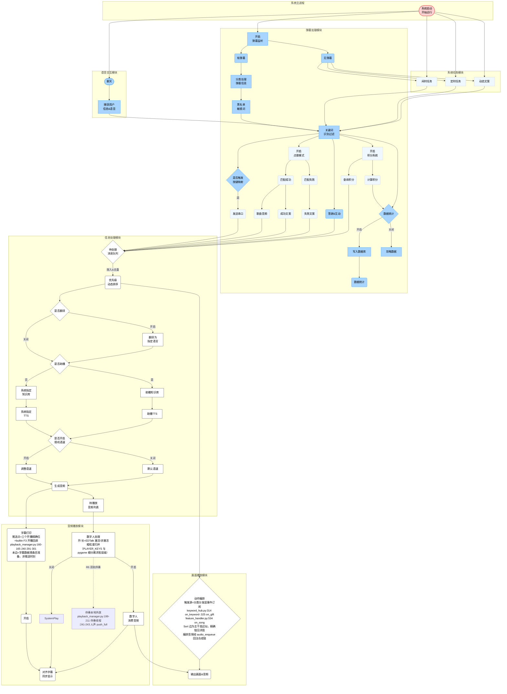

## Review record

<!-- autoplan-accepted:ceo -->
- 注记形式统一约定：C1-C4 的全部注记一律追加到节点文本内（`<br>` 分行，渲染可见），禁止 `%%` 注释（渲染不可见，防误读价值归零）。锚点口径（native F2 采纳）：符号名为主、行号为辅——行号随重构过期，验证与后续断言以符号名/文本片段 grep 为准，行号仅书写时参考。
- C1 图修正（P1，强制）：`AudioList --> SystemPlay` 直连边删除——播放分流为互斥三分支（utils/audio/playback_manager.py:198 is_edtalk_active / :261 PLAYER_KEYS / :293 pygame），SystemPlay 仅保留 AvatarAI 关闭分支入边；验证=图中 AudioList 出边仅 1 条（至 AvatarAI），SystemPlay 入边仅 1 条（来自 AvatarAI 关闭）。抽象口径注记（AvatarAI 节点文本）：开/关对应 EDTalk 激活/非激活粗粒度归并，PLAYER_KEYS 与 pygame 细分属详图层级。
- C2 图补充（P2，交付物=节点+边）：新增 `Backing[伴奏本地外放（R6 双轨）<br>playback_manager.py:199-211 伴奏线程<br>:241-243 人声 push_full]` 节点置于"音频播放模块"subgraph 内，加边 `AvatarAI -.->|R6 双轨伴奏| Backing`；验证=存在 Backing 节点且与 AvatarAI 相连（即钉死边本身）。
- C3 图注记（P2）：Compile 节点文本 `<br>` 追加触发源注记=分类分发层事件订阅，锚点=utils/keyword_hub.py:314（on_keyword）/:325（on_gift，经 KeywordHub.recognize 统一分发——2026-10-25 识别中枢改造后迁移）+ utils/handlers/feature_handler.py:534（on_song，choose_song 链）；`Sort --> Compile` 边为主干图近似；编排音频经 audio_enqueue 回注合成链（choreographer.py:582）。验证=Compile 节点文本含 keyword_hub.py 锚点。
- C4 图注记（P2）：Subtitle 节点文本 `<br>` 追加时序注记=推送点为三个开播精确位+builtin F3 开播回调（playback_manager.py:160-165,240,291,301），`GenerateAudio --> Subtitle` 表示字幕数据随条目准备而非推送时刻。详图残留处置：docs/flowchart-detail.md:105 Subtitle"出队时推送"注记因 91fb82cd 已过时，本批单文件（flowchartTD.md）不修，登记至 TODOS.md 待详图批次同步。验证=Subtitle 节点文本含"开播精确位"字样。
- C7 图头元数据（P2，本审查 F7 新发现）：主干图头部（```mermaid 后 `%%` 注释区）加三行——①版本行（v2.1，2026-10-26 图-码对齐批次，引用本审查记录）②图例引用行（四态语义〔真实/断链/骨架/规划〕定义见 docs/flowchart-detail.md:9-11 归档详图；主干图节点均为〔真实〕态或随节点注记标明）③纪律行（"改链必改图"——对应批次须同步检查本图节点/边，TODOS 2026-10-20 节 #5）。验证=图头含"v2.1"与"改链必改图"字样。注：此为图级元数据（`%%` 区），不受 C1-C4 节点文本注记约定约束。
- C5 defer 决议（边界钉死）：TODOS.md 2026-10-20 节 #3 的触发条件文字更新（"依赖：T1/T2 修图完成后"→"依赖：图 v2 调整版对齐完成后"）**属本批交付**（S）；冒烟断言实施本身 defer 维持登记。验证=TODOS.md #3 条目含更新后触发条件。defer 理由留痕+到期承诺（native F1/F3/F5 出口条件，采纳）：本批范围=图侧修正（零代码），断言脚本属代码面移交 Eng/后续批次；**下一改链/图对齐批次必须含 TODOS #3 冒烟断言实施**（可检查条件，不留开放式 defer）；最小断言切片（AudioList 出边=1、SystemPlay 入边=1 两条结构断言+图锚点可解析性 lint）作为条件性提案移交 Eng 阶段裁决。
- C6 defer 决议：编排静默窗口 busy-wait 观测、伴奏线程失败观测等代码侧隐患移交 Eng 阶段裁决，CEO 不越权定处置。
- 手册验收清单（交付/实播侧）：①C1-C4 修正后 mermaid 渲染无语法错误 ②下次"改链必改图"批次以修正后图为基线 ③TODOS.md 两处状态更新落盘（#3 触发条件+详图 :105 残留登记）。
<!-- /autoplan-accepted:ceo -->

<!-- autoplan-accepted:eng -->
- SC-1 断言切片纳入（P1，双声部同向：父线程 SC-1+native F3）：tests/test_flowchart_alignment.py 新建——2 条结构断言（图文本 `AudioList -->` 出边恰 1、`--> SystemPlay` 入边恰 1）+锚点可解析性 lint（图内 file:line/符号锚点 grep 命中）+图头断言（"v2.1"与"改链必改图"字样在位，防 restore 回滚复失，native F2）；lint 按符号名/文本片段 grep，禁止按行号断言（F4）。验证=pytest 全绿+人为恢复歧义边后断言红（防假绿抽查）。
- 实施约束（native F1/F8 采纳）：flowchartTD.md 落盘=应用 C1/C2/C3/C4/C7 后的完整目标图全文，禁止按计划内嵌快照整块复制（快照=修改前基线）；AvatarAI 开/关注记落 AvatarAI 节点文本内，禁止另造菱形判定节点（破坏断言边计数前提）。
- TODOS.md 更新四处（P1，T2）：①#3 触发条件改"图 v2 调整版对齐完成后"+断言已随本批实施的销账注记 ②#5 闭环失效订正（"2026-10-26 发现纪律行丢失（疑 restore 回滚），随 C7 重落盘"+restore 后核对项，native F2）③新增详图 :105 过时注记登记条目（P3，待详图批次）④新增 F6 两条 P3 观测项（编排静默窗口等待>60s 打点/并入 alarm_notifier；伴奏线程失败复用 alarm_notifier 报警项）。
- C6 移交隐患 Eng 终裁（native F6）：两项均属观测缺失非功能缺陷——登记 TODOS P3，本批不修（零运行时代码边界）。
- 锚点口径执行（F4）：图注记与断言一律符号名为主；C7 图例行注明"行号为书写时参考；四态 v1 以归档详图为准，修订须迁至活文档"（F5）。
- 手册验收（Eng 补充）：T3 pytest 全绿+防假绿抽查；验收清单①-④全过；F6 义务块双份清理（删 Implementation plan 节导出副本）。
<!-- /autoplan-accepted:eng -->

## Decision Audit Trail

| # | Phase | Decision | Classification | Principle | Rationale | Rejected |
|---|-------|----------|----------------|-----------|-----------|----------|
| 1 | ceo | C1 移除 AudioList→SystemPlay 歧义直连边 | Mechanical | P2 | 播放分流互斥三分支实证（playback_manager.py:198/261/293）；图内 1 行修正 | 保留歧义边（双声误读） |
| 2 | ceo | C2 伴奏双轨入图（Backing 节点+边） | Mechanical | P2 | R6 批次核心特性图中缺失；交付物钉死节点+边 | 仅注记（spec R1 I-5 否） |
| 3 | ceo | C3 编排触发源注记锚点改 keyword_hub.py:314/325 | Mechanical | P5 | spec R1 I-6 磁盘实测：识别中枢改造后调用点已迁移 | 旧 comment_handler/event_handler 锚点 |
| 4 | ceo | C4 字幕开播位注记+详图 :105 残留登记 TODOS | Mechanical | P5 | 91fb82cd 已落地；单文件纪律下不修详图只登记 | 本批修详图（破单文件纪律） |
| 5 | ceo→eng | C5 断言切片：初裁 defer→native 出口条件→Eng 终裁纳入本批（T3） | Taste | P1/P2 | 双声部同向（SC-1+native F3）；<5 文件<1d 无新 infra；防错误基线复利 | 维持开放式 defer（native F1/F3 否） |
| 6 | ceo | C6 代码侧隐患移交 Eng | Mechanical | 阶段分工 | Eng 是代码面 blast radius owner | CEO 越权定处置 |
| 7 | ceo | C7 图头元数据三行（F7 新发现） | Taste | P2 | 上批验收项在主干图不可见+restore 回滚丢失实证 | 不补（图例仅存归档详图） |
| 8 | eng | F1 实施约束=目标图全文落盘禁快照复制 | Mechanical | P5 | 消除整块复制产出未修正图的最自然实施歧义 | 快照加标注（约束更彻底） |
| 9 | eng | F2 TODOS #5 闭环失效订正随 C7 | Mechanical | P1 | restore 回滚实证（图头纪律行曾丢失）；台账继续失真 | 仅落盘不订正台账 |
| 10 | eng | F6 两观测项 defer TODOS P3 | Taste | P3 | 观测缺失非功能缺陷；本批零运行时代码边界；有 300s 防呆+F1 看门狗双层保底 | 随批修复（扩运行时范围） |
| 11 | eng | F4/F5/F8 口径采纳（符号锚点/四态 v1 锚归档/注记落节点） | Mechanical | P5 | 防行号漂移误导+归档文件不可修订+断言前提保护 | — |
