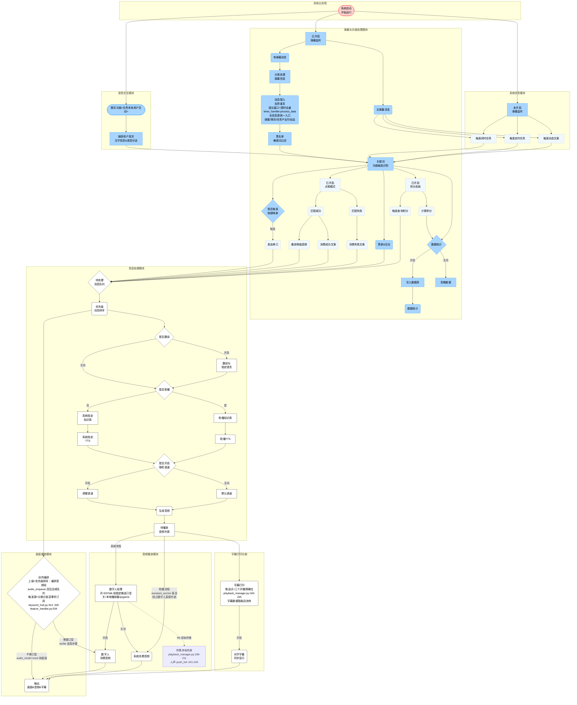

## v2.2 流程优化批次对账（2026-10-26，用户终图+代码实施）

- 调整项 1（Door 前移）：**代码已实现**——danmaku_consumer.py:494-547 分类分发后即 process_data（限时去重+遗忘窗口，timer_handler.py:269-293），到期 process_last_data 流入 comment_handle（Filter→Keyword）；聊天/任务/语音源同入口（web_server.py:312/task_scheduler.py:114,220,228/conversation_manager.py:68）。图 Door 节点补全信息源注记；Capture/Idle/Timed/DynamicCopy→Keyword 直连边为主干图近似（代码同经 Door）。
- 调整项 2（编排-数字人口型关联）：**代码已实现**——in_mute_window（audio_mode=none=不需口型→纯画面窗口）+tts/file 步骤正常驱动口型（playback_manager.py:212-237+choreographer.py:688-705）；图两路边标签补代码语义。
- 调整项 3（编排上级=优先级排序）：**用户语义裁决**——编排音频经 audio_enqueue 回注合成队列（choreographer.py:582），Sort→Compile 边保留；触发源=分类分发层事件订阅（keyword_hub.py:314/:325+feature_handler.py:534）以注记保留。
- 行为变更（助播分流）：**已实施**——playback_manager 新增 routes_to_edtalk（ASSISTANT_PLAYBACK_TYPES 绕过数字人直接外放，only_play_audio 分流点接线），守卫 4 项入 test_audio_playback_review.py（TestAssistantPlaybackRouting）。
- Listenoff（未开启监听仍触发任务）：**代码已实现**——main.py:260 task_scheduler.start_all() 无条件启动。
- 守卫恢复：用户手改覆盖了 v2.1 图头元数据与注记（T3 断言 4 项红精确预警，native Eng F2 预言场景重演）——本次合并恢复图头三行（v2.2）+Door/Compile/Subtitle/AvatarAI 注记+Backing 节点；T3 断言更新为 v2.2 语义（带标签双路+无标签歧义边守卫，防假绿抽查通过）+ANCHOR_REGISTRY 补 choreographer.py。
- 本批改动文件：docs/flowchartTD.md、utils/audio/playback_manager.py、tests/test_flowchart_alignment.py、tests/test_audio_playback_review.py、TODOS.md（助播行为变更待实播验收：助播文案/音频不再出数字人口型，改系统外放）。
