```mermaid
flowchart TD
    %% 图头 v2.13.2（2026-11-17 弹幕表情漏网根修批次）：拓扑不变——Filter 清洁链 remove_emoji 升级三级处理：表情括号三族匹配上限 16→32 + 迭代剥离至不动点（嵌套 [[爱心]）+ 未闭合标签兜底（开口+短标签直达串尾/空白，覆盖平台畸形标签与 max_char_len 截断截半形态——截断先于清洁，"...[爱"漏标签汉字）+ Unicode 补带（1F000-1F2FF/2300-23FF/20E3）。抖音实测 [爱心]/[赞]/[呲牙] 标准形态原链已覆盖，漏网通道=上述四类
    %% 图头 v2.13.1（2026-11-17 动作编排审查批次，用户裁决 B/B）：拓扑不变——⑨-B 歌队列逐歌对应（on_song_started 命中不同 song 规则=直切新规则主线 hold，新规则计数+1/旧规则保留，受理 max 不收缩 deadline）；⑦-B resident 文案消费精确对齐（挂起登记 copy 锚点，trends_copywriting 完成回执挂起期登记 copy_done/恢复期 hold 精确提前结束，qtype 过滤+归一化包含守卫）；⑧ song hold 放弃补齐 queue 模式。机制注记第 7/8 条
    %% 图头 v2.13（2026-11-13 流程图全面对齐批次，改链必改图追溯执行）：六簇图-码漂移修正——D1 弹幕窗口聚合退役（DANMU 逐条透传，限速归 process_data 遗忘定时器，LIKE 聚合保留）；D2 黑名单统一拦截前移 Door 前置（先于限入窗口/去重/分发）；D3 过滤清洁链四连批次（用户名数字转文字三级清洁链/弹幕内容字符白名单/表情括号三族匹配/filter.enable 总开关归一/答谢用户名白名单收口）；D4 点歌间奏插播机制整批（歌曲时间轴锚+间奏窗口门/借位插播走口型推理/伴奏双轨闪避/队列容量分账/静音自适应识别）；D5 拼多多mall_id 接入+登录根修+tuber 角色库（采集与数字人配置面）；D6 翻译 LRU 缓存+LLM 并发信号量。伴奏双轨以注记呈现（终门 uc1a）；正文新增「机制注记」小节（渲染可见）；图头本批 7 行不折叠（v2.14 折叠挂账 TODOS）
    %% 图头 v2.12（2026-11-06 三强制拆除批次）：entrance/follow 权重两态回归系统优先级——on 态 d10 表外回读 filter.priority_mapping（覆盖顺序=arbitration_weights > priority_mapping）、off 态 _TRIGGER_PRIORITY_KEY 新增同名直取；打断模式回归规则配置（standard/queue 均合法）；10s 类型节流与装载告警退役（防御职责归上游 process_data 六类限入&去重管线）；username 清洗三件套保留
    %% 图头 v2.11（2026-11-06 协作机制流程审查批次 T3，uc1b 终门裁决）：消费回传语义澄清——回传=观测回执（QueueMixin.report_consumed 消费统计落账+编排实例匹配），不驱动下一消费（消费由播放循环自身串行推进）；本地（builtin）路径观测回执收敛至真实完成点单点（audio_core 完成回调），移交点仅保留编排实例匹配（W3 双计根修）；编排音轨条目重建透传 choreo_step_id（Q-1）
    %% 图头 v2.10（2026-11-01 动作编排优化批次）：T3 动态文案「关键词|文案」拆分——格式化条目关键词直投编排（DynamicCopy→Compile 直通边，跳过 Keyword 中枢子串识别）、文案部分直通播放链、copywriting 文件夹链与未格式化条目走既有链不变；T4 entrance/follow 触发实装——入场/关注事件（感谢链同源 event_handler）经编排订阅点直投 Compile（三强制：10s 类型节流/强制 queue/权重恒钳 0，username 清洗三件套）
    %% 图头 v2.9（2026-10-28 消费批次 P3）：打断撤旧音频（standard 打断撤销旧序列未消费编排音轨 CancelAudio→两队列按 choreo_step_id 移除）；消费回传补齐 pygame/外部播放器路径（三路共用 _notify_choreo_complete，M3 断链修复）；消息队列满载高优插入=插队+驱逐队尾净长度不变（M1）；完成匹配回退路径 content 归一化容差（O9）。拓扑与 v2.8 一致
    %% 图头 v2.8（2026-10-28 消费批次 O1/O3/O6/O7）：编排接入 Sort 权重表——queue 排队按 filter.priority_mapping 权重降序出队、standard 打断加权重门（低权让位排队）、满额挤最低优；消费回传携带编排实例序号 choreo_step_id（同内容重复触发按实例精确匹配，未透传路径退回 type+content）；编排音轨（tts 答谢/file 歌曲）注入 priority_override=500 于两级队列插队（低于 999 专线）。拓扑与 v2.7 一致
    %% 图头 v2.7（2026-10-28 消费逻辑审查批次，用户终版手改定稿）：已消费回传子图回传目标 Sort→AudioList——消费完成回执落音频队列模块（QueueMixin.report_consumed 消费回执+播放循环完成点后串行取下一条，G1/G2 两路消费点互斥不双报）；其余拓扑与 v2.6 一致（Keyword 中枢→Compile 双出边、Sort 权重边、NoDM/Listenoff 闲时任务调度）
    %% 图例：{菱形}=判断/路由节点 | ([圆角])=起止节点 | :::listenNode=监听交互 | :::subLogicNode=子逻辑 | :::logicNode=核心处理 | 无箭头依赖=并行支路
    %% 纪律：改链必改图——任何链路代码变更须同步本图并升级版本号；守卫 tests/test_flowchart_alignment.py 断言图头与编排拓扑边
    %% 样式定义
    classDef startNode fill:#FFD3D3,stroke:#FF6666,stroke-width:2px,color:#000;
    classDef listenNode fill:#A8D5FF,stroke:#3399FF,stroke-width:1px,color:#000;
    classDef sysTaskNode fill:#3399FF,stroke:#0066CC,stroke-width:1px,color:#000;
    classDef processNode fill:#D9EDFF,stroke:#99CCFF,stroke-width:1px,color:#000;
    classDef logicNode fill:#FFFFFF,stroke:#333333,stroke-width:1px,color:#000;
    classDef subLogicNode fill:#F0F8FF,stroke:#CCCCCC,stroke-width:1px,color:#000;
    classDef endNode fill:#F4F4F5,stroke:#999999,stroke-width:1px,color:#000;

    %% 主线程
    subgraph 系统主进程
        System([系统启动<br>开始运行]):::startNode
    end

    %% 聊天模块
    subgraph 语音交互模块
        System --> Chat([聊天功能<br>负责本地用户互动]):::listenNode
        Chat --> Capture[捕获用户发言<br>文字信息&语音对话]:::listenNode
    end

    %% 系统任务
    subgraph 系统任务模块
        System --> Listenoff[未开启 <br> 弹幕监听]:::listenNode
        Listenoff --> Idle[触发闲时任务]:::subLogicNode
        Listenoff --> Timed[触发定时任务]:::subLogicNode
        Listenoff --> DynamicCopy[触发动态文案]:::subLogicNode
        NoDM --> Idle
        NoDM --> Timed
        NoDM --> DynamicCopy
        Capture --> Keyword
        Idle --> Keyword
        Timed --> Keyword
        DynamicCopy --> Keyword        
    end

    %% 按键映射
    subgraph 按键映射功能
        Keyword --> Keymap{是否触发<br>按键映射}:::listenNode
        Keymap --> |触发| SendPort(发送串口):::subLogicNode        
    end

    %% 弹幕处理流程
    subgraph 弹幕前置处理
        %% v2.13 对齐（D1/D2/D3）：弹幕监听侧窗口聚合退役——DANMU 逐条透传进分类，限速与合并归 Door 遗忘定时器（LIKE 聚合保留）；
        %% Door=黑名单统一拦截最前置（名单内一切互动直接抛弃，先于限入窗口/去重/分发/关键词识别）→消息限入（遗忘窗口：首条立即分发+窗口末补发保留数）→限定时间重复丢弃；
        %% Filter=违禁词/敏感词过滤+清洁链（用户名清洁三级链归「用户名数字转文字」开关、弹幕内容字符白名单清洁归「弹幕表情过滤」链、表情括号三族匹配+迭代剥离+未闭合兜底（2026-11-17 漏网根修）；filter.enable 总开关归一）
        System --> Listening[已开启 <br> 弹幕监听]:::listenNode
        Listening --> NoDM(无弹幕消息):::listenNode
        Listening --> HasDM(有弹幕消息):::listenNode
        HasDM --> Classify[分类处理<br>弹幕信息]:::listenNode
        Classify --> Door(黑名单拦截<br>消息限入<br>去除重复):::listenNode
        Door --> Filter[违禁&敏感词过滤<br>清洁链]:::listenNode
    end

    %% 功能触发
    subgraph 功能处理模块
        Filter --> Keyword[功能关键词<br>触发判断]:::listenNode
        Keyword --> SongMode[已开启<br>点歌模式]:::subLogicNode
        SongMode --> Match(匹配成功):::subLogicNode
        Match --> done(消费成功文案):::subLogicNode
        Match  --> sing(播放歌曲音频):::subLogicNode
        SongMode --> miss(匹配失败):::subLogicNode
        miss --> misMatch(消费失败文案):::subLogicNode
        Keyword --> Points[已开启<br>积分系统]:::subLogicNode
        Points --> Calc(计算积分):::subLogicNode
        Keyword --> Stats{数据统计}:::listenNode
        Calc --> Stats
        Points --> look(触发查询积分):::subLogicNode
        
        
        Stats --> |开启| DB[写入数据库]:::listenNode
        Stats --> |关闭| Ignore[忽略数据]:::listenNode
        DB --> Result(数据统计):::listenNode
        Keyword --> Interact(答谢&互动):::listenNode
        
    end

    %% 核心处理流程
    subgraph 信息处理模块
        %% v2.9 消息队列满载语义（M1/M2）：扫描/判定/插入锁内化（多生产者竞态根修）；
        %% 满载高优插入=插队+驱逐队尾（最低优组 FIFO 尾）净长度不变，低优/未识别类型仍丢弃
        Queue{待处理<br>消息队列}:::logicNode
        look --> Queue
        SendPort --> Queue
        sing --> Queue
        done --> Queue
        misMatch --> Queue
        Interact --> Queue
        Queue --> Sort(优先级<br>动态排序):::logicNode
        Sort --> |答复&弹幕文本|text{文本信息<br>需要合成}:::logicNode
        Sort --> |点歌音频|file{本地音频<br>歌曲切片&间奏窗口}:::logicNode
        text --> TranslateQ{是否翻译}:::logicNode
        TranslateQ --> |开启| Translate[翻译为<br>指定语言]:::logicNode
        TranslateQ --> |关闭| KBQ{是否助播}:::logicNode
        Translate --> KBQ
        KBQ --> |否|SysKB[系统指定<br>知识库]:::logicNode
        KBQ --> |是|AsstKB[助播知识库]:::logicNode
        SysKB --> SysTTS[系统指定<br>TTS]:::logicNode
        AsstKB --> |文本匹配|AsstTTS[助播TTS]:::logicNode
        SysTTS --> SpeedQ{是否开启<br>随机语速}:::logicNode
        AsstTTS --> SpeedQ
        SpeedQ --> |开启|ChangeSpeed[调整语速]:::logicNode
        SpeedQ --> |关闭|DefaultSpeed[默认语速]:::logicNode
        ChangeSpeed --> GenerateAudio(生成音频):::logicNode
        DefaultSpeed --> GenerateAudio
        GenerateAudio --> AudioList[待播放<br>音频列表]:::logicNode
        AsstKB --> |本地音频|AudioList
        file --> AudioList
    end 
    %% 字幕打印
    subgraph 字幕打印功能
        AudioList --> Subtitle(字幕打印):::logicNode
        Subtitle --> |开启|Sync(对齐字幕<br>同步显示):::logicNode 
    end       
    %% 输出与播放模块
    subgraph 音频播放模块
        %% v2.13 对齐（D4 点歌间奏插播机制整批落注，详见正文「机制注记」小节）：
        %% 歌曲时间轴锚+间奏窗口门——队首 song 切片段按 .silences.json 坐标窗口消费（段边界只依坐标不二分）；
        %% 借位插播——间奏/前奏窗口内插播其他音频条目，插播条目推数字人口型推理（不本地外放），点歌应答先播，窗口预检播完须留 ≥3s，时间轴保持前进；
        %% 伴奏双轨（注记呈现，终门 uc1a）——伴奏本地子进程播放，借位插播出声期伴奏降 50%，播完恢复；
        %% 队列容量分账——song 切片段不占普通音频容量+满载豁免；普通音频条目照常占容量
        AvatarAI --> |关闭|SystemPlay(系统消费音频):::logicNode
        AudioList --> |助播流程|SystemPlay
        AudioList --> |系统流程|AvatarAI[数字人服务]:::logicNode
        AvatarAI --> |开启|AvatarPlay[数字人推理<br>消费音频]:::logicNode

    end
    %% 画面输出模块
    subgraph 画面播放模块  
        %% v2.8 权重联动落码：Compile 排队按 filter.priority_mapping 权重降序出队（O1，
        %% keyword→comment/gift/song 同名映射）、standard 打断权重门低权让位改排队（O3）、
        %% 满额挤最低优组最旧（O2）；编排音轨（tts 答谢/file 歌曲）注入 priority_override=500
        %% 于两级队列插队（O7，低于 999 复读专线）
        %% v2.9 补齐：standard 打断撤销旧序列未消费音轨（O8，CancelAudio→按 choreo_step_id
        %% 移除两队列条目）；完成回传按 choreo_step_id 实例精确匹配（O6，同内容重复触发不误配），
        %% 未透传路径退回 type+content 归一化容差匹配（O9）
        Keyword --> |关键词|Compile{动作编排}:::logicNode
        %% T3：动态文案格式化条目（「关键词|文案」）关键词直投编排（跳过中枢子串识别）；
        %% 未格式化条目仍走 DynamicCopy→Keyword 既有链
        DynamicCopy --> |关键词直投·格式化条目|Compile
        %% T4：入场/关注事件订阅（感谢链同源 event_handler.entrance/follow_handle；
        %% 权重=系统优先级/打断模式=规则配置——2026-11-06 三强制拆除批次）
        Sort --> |权重&队列信息|Compile
        Frame(输出<br>画面&音频&字幕):::logicNode      
        Compile --> |需要口型|AvatarAI
        Compile --> |不需口型|Frame
        AvatarPlay --> Frame
        SystemPlay --> Frame
        Sync --> Frame
    end    

    %% 消费完成（v2.9：消费回传三路全覆盖互斥不双报——EDTalk push 完成点/builtin
    %% 完成回调由 audio_core 转发/pygame get_busy 结束点/外部播放器移交点；
    %% 回传同时落 QueueMixin.report_consumed 消费回执+编排实例匹配）
    subgraph 已消费信息回传 
        Frame --> lineout{已消费信息}:::logicNode
        lineout --> |回传|AudioList
    end     
```

## 机制注记（v2.13 对齐批次补全，2026-11-13）

本节为图外正文（渲染必见），记录主干图未展开的机制语义；file:line 收据只落本节（图内块禁 .py:数字 引用）。

### 点歌间奏插播机制（D4）

1. **静音识别与切片**：点歌成品先经静音识别产出 .silences.json 坐标文件（utils/audio/vocal_silences.py 的 compute_silences：RMS 自适应阈值双峰分离+频谱能量验证二道防线+小间隔合并），合成侧按坐标把人声切成段；段边界只依坐标，不做时长二分兜底（用户模型②，2026-11-12 R6 用户指令）。
2. **时间轴锚与间奏窗口门**：播放侧为队首 song 切片段建立歌曲时间轴锚，段消费受间奏窗口门约束（utils/audio/playback_manager.py 的 _song_gate_wait_s）——未到窗口不开闸；前奏段按扫描索引弹出对齐；播完保底兜底失步。
3. **借位插播**：间奏/前奏窗口内其他音频条目借窗口插播（点歌段之间穿插普通播报）；插播条目推数字人口型推理、不本地外放（用户模型①，2026-11-12 实测确认）；点歌应答文案先播不排队；窗口预检要求插播播完后歌曲段还能留足 3 秒（用户模型③）；时间轴保持前进——与 999 复读模式的唯一区别（用户模型⑤）。
4. **伴奏双轨与闪避**（注记呈现，终门 uc1a）：伴奏经本地子进程播放（utils/audio/playback_manager.py 的 _start_backing_player，子进程不可用降级本地线程）；借位插播出声期伴奏压低至 50%（_backing_duck_hold 写 _BACKING_DUCK_FACTOR），播报播完按时长定时恢复（_backing_duck_release_later），人声段出队/停止路径立即恢复（_backing_duck_release_now）。
5. **队列容量分账**：song 切片段不占普通音频队列容量（utils/audio/queue_manager.py 容量分账+voice 队列满载豁免，用户模型④）——80 条丢弃根修（2026-11-10 R4h）。
6. **双门控背压**（2026-11-16 两批次）：①合成背压门——待播放队列普通条目深度 ≥ `play_audio.synth_gate_depth`（缺省 2）时合成线程暂停出队，消费出队回执唤醒（豁免：song 切片段/权重≥500/念白配对 pending 回复；min_start_play>门限取大防首播阈值互锁）；②弹幕↔回复配对门（念白单飞）——念白与 LLM 回复同 `reply_link`，念白出队登记 pending，其回复出队前后续念白留队（15s 超时兜底，无回复路径显式 abandon）。
7. **song hold 编排放弃（2026-11-17 动作编排审查批次）**：点歌画面 hold 期间所有非 song 触发（gift/keyword/entrance/follow/dynamic_text，standard 与 queue 模式均同）一律放弃——不排队不挂起不切画面（设计 8「只保留再次命中的点歌规则」）；放弃分支先于 interrupt=queue 入队分支（原 queue 分支先入队、歌毕重放切换画面的行为已退役）；song×song 重触发仍走 d11 歌曲队列承接（accepted=true，序列保持 hold）。
8. **⑨-B 歌队列逐歌对应 + ⑦-B resident 文案消费精确对齐（2026-11-17 动作编排审查批次，用户裁决 B/B）**：逐歌对应——歌队列中下一首人声切片起播（on_song_started 权威信号）命中**不同** song 规则时，画面直切新规则主线 hold（不重插旧离场=歌队列连续性；新规则计数+1 按档位升档、旧规则计数保留不清零=非打断语义），切歌受理 deadline=max(保险丝, 锚点+剩余时长) 不收缩，同规则重触发/无规则命中=保持当前画面仅刷新 deadline，编排总开关 off=回退既有刷新语义；文案精确对齐——resident 挂起时登记其文案匹配值锚点，trends_copywriting 完成回执（type+content 归一化双向包含匹配，qtype 过滤防他链路误配）：挂起期到达=登记 copy_done（打断者完成后跳过切回直回默认轮播，防 hold 闪帧）、恢复 hold 期到达=hold 精确提前结束回默认（不再只依赖 step_timeout_s 保险丝）。

### 弹幕管线（D1-D3）

- **聚合退役（D1）**：弹幕监听侧五秒窗口聚合器整体退役（ca5408e1，用户实播验收）——DANMU 逐条透传进分类处理，限速与窗口合并职责归 Door 遗忘定时器（首条立即分发+窗口末补发保留数-1 条）；LIKE 点赞聚合保留。
- **黑名单前置（D2）**：黑名单统一拦截是 process_data 第一步（utils/handlers/timer_handler.py）——名单内用户的一切直播间信息直接抛弃，先于限入窗口/去重/分发/关键词识别；弹幕链内拦截保留双保险（utils/handlers/comment_handler.py）。
- **清洁链（D3）**：用户名清洁三级链（表情标签三族【半角方括号/全角方头/方头】+emoji 序列、噪音字符、回复语言字符白名单——保留集由通用「回复语言」决定，全滤空则「观众」保底）归「用户名数字转文字」开关，数字转文字在其后；弹幕内容字符白名单清洁（恒中英日韩）归「弹幕表情过滤」链；filter.enable 总开关归一（旧键消费侧恒放行根修，0af01844）；答谢链用户名白名单收口（GSV 空段防御归 fork 源码守卫）。

### 采集与数字人配置面（D5/D6）

- 拼多多 mall_id 接入+直播间链接归一落库+多对象帧遮蔽丢帧根修（c64dc53d/b7638690，用户实机验收）；登录入口存在性判定根修（会话校验器/入口放行/关窗守卫）。
- 数字人模型管理以角色为单位（tuber 角色库，每角色一包；character_dir 语义升级为当前启用角色）。
- 翻译链强化：LRU 缓存（容量 512，四通道共用）+LLM 并发信号量（槽位准入，超时走本地问答托底）——图面 Translate 节点语义不变。
