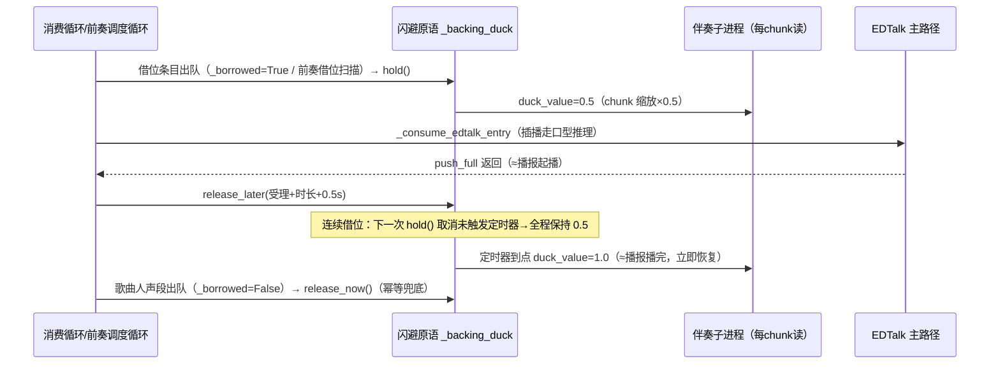

# 伴奏闪避 — 技术设计文档

## 1. 设计概要

**功能描述**：前奏/间奏窗口内插播非歌曲音频时，伴奏音量自动降为原音量的 50%，插播播完立即恢复；歌曲人声不触发。

**影响范围**：`utils/audio/playback_manager.py`（消费循环+伴奏编排）、`utils/audio/backing_player.py`（伴奏子进程原语契约）、新增守卫测试。

**技术难点**：①伴奏音量目前是起播时一次性烘焙（pydub apply_gain），无运行时动态控制通道——需新增跨进程闪避原语；②"播完"判定：R5b 回滚后借位条目走 EDTalk 主路径，`push_full` 返回=受理（起播）非播完，恢复时刻需按「受理+时长」估计；③前奏借位（R5c）在 `_consume_edtalk_entry` 内部递归消费，是独立于消费循环的第二个挂点。

**外部依赖**：无新增（audioop 为标准库，且 pydub 自身已依赖它——不扩大子进程 import 面）。

---

## 2. 架构概览

伴奏子进程已有「三原语」跨进程契约（start_event 门 / started 回执 / stop_event 协作停止）。本设计新增第四原语 **duck_value**（主→子，`mp.Value('d')`，1.0=原音量）：主进程在借位消费生命周期内写 0.5/1.0，子进程写流循环**每 chunk 读取并按系数缩放 PCM**（audioop.mul，C 实现）。chunk≈93ms → 闪避生效延迟 ≤~100ms，听感即时。降级线程路径（mp 不可用）用 dict 载体同型支持。

闪避生命周期（三个幂等原语方法，全 fail-soft）：

- `_backing_duck_hold()`：取消未触发的恢复定时器 + 写 0.5（**受理=播报出声时**，见下）；
- `_backing_duck_release_later(entry)`：按「受理+时长+0.5s 余量」起 `threading.Timer` 恢复（push_full 返回≈播报起播，定时器到点≈播报播完）；时长未知（pydub fail-soft=0）不定时——等待下一次非借位 pop 或停止路径恢复（fail-soft 降级）；
- `_backing_duck_release_now()`：取消定时器 + 写 1.0（歌曲人声段出队/异常路径/停止路径）。

**压低点=受理而非出队（2026-11-12 song6.log 实测修正）**：②b 窗口预检可在人声段未唱完时出队借位条目（窗口=[now, 下一段 due] 含人声尾巴；播报经 push 飞行等待把实际出声推迟到真实间奏——出队到出声可隔 60s+）。出队即压低会把正在唱的人声伴奏压掉（用户实测「进入唱歌后伴奏音量并不会恢复」）。修正后：出队不压（飞行等待期人声全量伴奏），`_consume_edtalk_entry` 返回（=push_full 受理=播报出声）才 hold+release_later。



**触发面精确口径**（与 AC 对齐）：
- 消费循环 `_borrowed=True`（`_pop_next_entry_locked` ②b 插播/②c 间奏借位）→ 闪避；`False`（song 段/999 豁免/垃圾时间自由消费/收尾间隙自由消费）→ 不闪避且顺带恢复；
- 前奏借位（R5c 调度循环，队列扫描 pop，不经 `_pop_next_entry_locked`）→ 闪避；
- 已知边界（刻意不覆盖，用户确认严格口径）：999 豁免 pop（②a，False）不闪避；垃圾时间/收尾间隙（伴奏尾奏期间的自由消费）不闪避。

---

## 3. 数据库设计

无（不涉及存储）。

## 4. API 设计

无新增端点（纯内部播放链机制，无配置面——用户决定固定 50%）。

---

## 5. 核心逻辑

### 5.1 闪避生命周期原语 → AC-001/002/003/006/007

`PlaybackMixin` 新增四方法（+模块常量 `_BACKING_DUCK_FACTOR = 0.5`、`_BACKING_DUCK_RELEASE_MARGIN_S = 0.5`）：

```
_set_backing_duck(factor)     # 底层写：双形态原语（mp.Value.value / dict["v"]）；
                              # 原语缺失（无伴奏/整轨模式）no-op；仅状态翻转时打日志
_backing_duck_hold()          # 取消恢复定时器 + _set_backing_duck(0.5)
_backing_duck_release_later(entry)  # 取消旧定时器；dur=_entry_duration_s(entry)>0 时
                              # 起 threading.Timer(dur+0.5, release_now)
_backing_duck_release_now()   # 取消定时器 + _set_backing_duck(1.0)
```

状态载体：`self._backing_duck`（原语）、`self._backing_duck_restore_timer`（Timer|None）、`self._backing_duck_lock`（定时器句柄与状态翻转互斥；主进程单写者多读者，GIL+对齐 double 足够，锁只保护句柄置换与日志判定）。

### 5.2 子进程每 chunk 缩放 → AC-001/002/008

`backing_player._backing_process_main` 写流循环改造：

```
while data:
    if stop_event 置位: break
    factor = _read_duck(duck_value)          # 双形态读+clamp[0,1]+fail-soft 1.0
    if factor < 0.999:
        data = _scale_chunk(data, wf.getsampwidth(), factor)  # audioop.mul，fail-soft 原样
    stream.write(data)
    data = wf.readframes(4096)
```

`_play_backing_local`（降级线程）同型改造（duck_box dict 载体，chunk=1024 帧≈23ms）。缩放只发生在 factor<1 时——正常路径零开销（不复制 chunk）。

### 5.3 消费循环挂点（P2/P3 间奏借位/插播）→ AC-001/002/003/004/006

`only_play_audio` 三处手术（逐字保持既有分支语义）：

1. 出队后：`if _borrowed: hold() else: release_now()`（人声段恢复=幂等兜底）；
2. EDTalk 分支既有 try/finally 内追加：`_consumed_ok` 标记——成功 `release_later(data_json)`，异常 `release_now()`；builtin 分支（助播借位）移交点后 `release_later`；
3. 外层 `except Exception` 兜底追加 `release_now()`（内层 finally 未触达的逃逸路径——AC-006 不悬挂）。

### 5.4 前奏借位挂点（P1，R5c 调度循环内）→ AC-001/002/006

`_consume_edtalk_entry` 前奏窗口调度循环的递归消费点（691 行）同 5.3-② 形态包裹：hold → 递归消费 → 成功 release_later / 异常 release_now。该路径伴奏必然已起播（前奏期），原语必然存在。

### 5.5 停止/切歌 → AC-007

- `_start_backing_player`：启动即取消残留定时器 + 新建原语（子进程 `mp.Value('d', 1.0)` / 降级 dict）——新歌天然全量起播；
- `_stop_backing_player`：取消定时器 + 置 `self._backing_duck = None`（后续 hold/release 全 no-op）。

---

## 6. 现有代码改动

| 模块 / 文件 | 改动内容 | 原因 | 对应 AC |
|-------------|---------|------|---------|
| `utils/audio/backing_player.py` | 模块契约文档三原语→四原语；新增 `_read_duck`/`_scale_chunk`；`_backing_process_main`+`play_backing_in_process` 增加 `duck_value` 参数，写流循环每 chunk 缩放 | 伴奏无运行时音量通道，需跨进程原语 | AC-001/002/008 |
| `utils/audio/playback_manager.py` | 常量+四生命周期方法；`_play_backing_local` 增加 `duck_box`（降级线程同型）；`_start_backing_player` 建原语+清残留；`_stop_backing_player` 清原语+定时器；`only_play_audio` 三处挂点；`_consume_edtalk_entry` 前奏借位点包裹 | 闪避触发/恢复生命周期与双挂点接线 | AC-001~007 |
| `tests/test_backing_player.py` | 既有 fake 基建上补 duck 缩放/恢复/fail-soft 用例 | 守卫 | AC-001/002/008 |
| `tests/test_song_backing_duck.py`（新） | 生命周期原语单测+消费循环/P1 前奏借位行为级守卫（复用 `_PlaybackHost` 驱动拓扑） | 守卫 | AC-001~007 |

---

## 7. 技术决策

### 恢复时刻：定时器估计 vs 消费完成点

**背景**：R5b 后借位条目走 EDTalk 主路径，`push_full` 返回=受理（起播）非播完；循环受理后立即取下一条。
**选项**：A: 受理即恢复 — 实现最简，但伴奏在播报仍在播时回满音量，功能失效。B: `threading.Timer(受理+时长+0.5s)` 恢复 — 与 `last_end=受理+preroll+段时长` 同源的估计口径（项目既有模式），听感「播完即恢复」；连续借位靠 hold() 取消未触发定时器保持连续压低（AC-003 精确成立）。
**结论**：B。定时器线程化与 mixin 既有 threading.Event/Timer 风格一致，不耦合消费循环的事件循环。

### 压低时刻：出队 vs 受理（song6.log 实测修正）

**背景**：②b 窗口预检可在人声段未唱完时出队借位条目（窗口含人声尾巴，播报经 push 飞行等待推迟到真实间奏出声——实测出队到出声隔 60s+，期间人声在唱）。
**选项**：A: 出队即压低（初版）— 出声前 60s+ 伴奏被压=唱歌中伴奏被压（用户实测发现）。B: 受理（`_consume_edtalk_entry` 返回=push_full 受理=播报出声）才压低+起恢复定时器 — 闪避与播报可闻性精确对齐，飞行等待期人声全量伴奏。
**结论**：B。窗口模型与飞行等待的时序错位是既有调度语义，闪避必须锚定"实际出声"而非"出队"。

### PCM 缩放实现：audioop vs numpy vs 重导出

**背景**：子进程按 chunk 写原始 PCM 帧，需要按系数缩放采样。
**选项**：A: `audioop.mul`（标准库，C 实现）— 零新增依赖、零 import 面扩大（pydub 自身即依赖 audioop，随 pydub 同生共死）；B: numpy — 每 chunk frombuffer/乘/tobytes，可读性好但扩大子进程薄入口 import 面（冷启动契约）；C: 按两档音量预导出两份文件切换 — 复杂度高、磁盘 IO、切换粒度粗。
**结论**：A，per-chunk fail-soft（缩放失败按原样写=闪避降级不压，不影响播放）。

### 触发面：严格 `borrowed` 标志 vs 「非 song 条目且伴奏存活」

**背景**：999 豁免 pop（②a，False）与垃圾时间自由消费在伴奏存活时也可能是非 song 音频。
**选项**：A: 严格标志（②b/②c True + 前奏借位点）— 与用户确认口径逐字对齐（唱歌期间打断消息不闪避），行为可预期；B: 按伴奏存活+非 song — 覆盖更广但会把 999-唱歌期/垃圾时间也卷入，越过用户明确划定的范围。
**结论**：A。999 豁免与垃圾时间边界在文档登记，实播后如需扩展为两行改动。

---

## 8. 安全与性能

**性能考量**：缩放仅在 factor<1 时发生（闪避窗口内每 chunk 一次 audioop.mul，16KB/93ms，CPU 可忽略）；正常路径 factor≥0.999 直接写原帧零复制。Timer 线程每次借位至多 1 个，寿命=时长+0.5s。

---

## 9. AC 覆盖总表

| AC 编号 | 验收标准概述 | 实现位置 |
|---------|-------------|---------|
| AC-001 | 前奏/间奏窗口插播起播时伴奏降 50% | 5.3 挂点1（hold）+ 5.4 前奏挂点 + 5.2 子进程缩放 |
| AC-002 | 播报播完立即恢复 | 5.1 release_later（受理+时长+0.5s≈播完） |
| AC-003 | 连续插播持续压低到最后一条播完 | hold() 取消未触发定时器 + release_later 重排 |
| AC-004 | 歌曲人声不触发闪避 | 挂点1 `else: release_now()`（song 段恒 _borrowed=False）；闪避写点仅借位路径 |
| AC-005 | 纯窗口不误压 | 无借位 pop 即无 hold 写点；原语恒 1.0 |
| AC-006 | 异常路径不悬挂 | 5.3-② finally 异常分支 release_now + 5.3-③ 外层 except 兜底 + 5.4 同型 |
| AC-007 | 停止/切歌不残留 | 5.5 新歌新建原语(1.0) + stop 清原语/定时器 |
| AC-008 | 仅伴奏音量变化 | 缩放只作用于伴奏子进程 chunk；播报/人声路径零触碰 |

---

## 附录：变更记录

| 日期 | 变更内容 | 原因 |
|------|---------|------|
| 2026-11-12 | 初始版本 | — |
